<p align="center">
  
</p>

<p align="center">
  <b>I'm a product engineer who builds production systems end to end: AI dev tooling, data platforms on Postgres and AWS, and the real-time apps on top.</b><br>
  By day I build a production compliance platform and the AI tooling around it. On nights and weekends I'm building a browser FPS with its own authoritative multiplayer server.
</p>

<p align="center">
  <a href="https://www.dotslayer.live"></a>
  <a href="https://jrotto5.github.io/neon-spin/"></a>
  <a href="https://nfl-edge-kappa.vercel.app"></a>
  <a href="https://github.com/JROtto5/sith-os"></a>
</p>

| | |
|---|---|
| **crucible v0.4** | **[crucible](#crucible)**, the open-source AI PR reviewer I built: every finding has to survive an attempt to disprove it before anyone reads it |
| **21 PRs merged upstream in under 3 weeks** | In 8 open-source projects (three-mesh-bvh, Lutris, MangoHud, MapLibre, Supavisor, colyseus, ProtonUp-Qt, GitPython), plus 5 fixes maintainers built from my reports |
| **3,030 PRs · 88% merged** | The past year on GitHub: 6.2k commits across 41 repos, 242 active days |
| **94k lines · 1,190+ commits** | **Dragon Front**: a browser FPS I built from an empty folder, solo, with AI pair-programming under my review |
| **~5k-line authoritative server** | My own Node netcode: binary delta snapshots, client prediction, lag compensation, bot backfill |
| **4 live apps you can open now** | DotSlayer, NEON SPIN, The Edge Board, Draft War Room, plus my own Arch Linux distro |

<p align="center">
  <a href="#crucible"></a>
  <a href="#activity"></a>
  <a href="#how-id-work-with-your-team"></a>
  <a href="#dragon-front"></a>
  <a href="#production-engineering"></a>
  <a href="#products"></a>
  <a href="#games--creative-code"></a>
  <a href="#linux"></a>
</p>


<p align="center">
  <a href="https://github.com/JROtto5/crucible">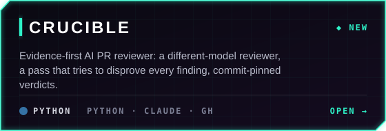</a>
  <a href="case-studies/dragon-front.md">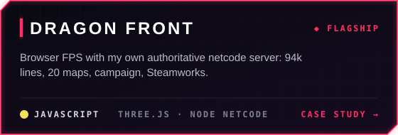</a>
  <a href="https://github.com/JROtto5/dot-universe">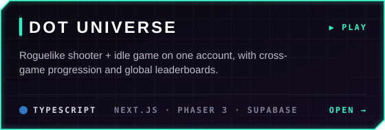</a>
  <a href="https://github.com/JROtto5/nfl-edge">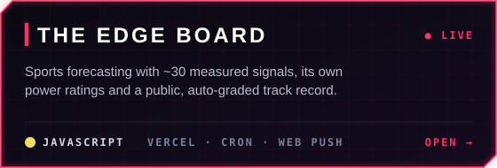</a>
  <a href="https://github.com/JROtto5/draft-war-room">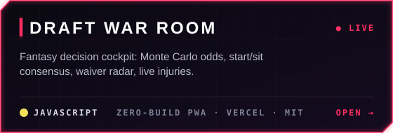</a>
  <a href="https://github.com/JROtto5/sith-os">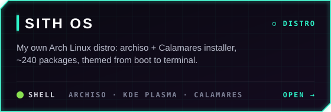</a>
  <a href="https://github.com/JROtto5/neon-spin">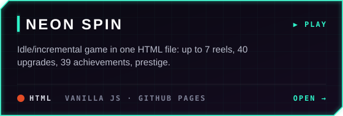</a>
</p>

## crucible

**[crucible](https://github.com/JROtto5/crucible)** is the AI code reviewer I built and maintain. Every open-source PR I send goes through it first; it never posts, I submit. MIT, Python standard library only.

| Version | What it added |
|---|---|
| **v0.1** | The core loop: a reviewer on a different model from the one that wrote the change, a verification pass that tries to disprove every finding, verdicts pinned to one commit, and an answer (fixed, refuted, deferred) for every finding |
| **v0.2** | Runs the project's own build and tests, learns its house style and maintainer rules from merged PRs, executes code to verify a finding, and checks PR readiness (linked issue, tests, description) |
| **v0.3** | A labelled eval of planted bugs that every change is scored against, tiered verification (a cheap model first, the strong one on what survives: same recall, 24% cheaper), and incremental re-review of only what changed |
| **v0.4** | Reads past the diff: the docs, comments and call sites elsewhere in the repo that a change affects. Verified nits for copied blocks, dead code and security hardening gaps. A warning when another change defines the same symbols or adds out-of-order migrations. A per-call model fallback when an account hits a spend limit |
| **next** | API-design checks (a new pattern beside the repo's existing one), reliability (error paths, retries, cleanup), and one-command install |

**A recent catch.** It flagged a signal race in Valve's gamescope reaper. The same window was in another contributor's fix for that bug; they reproduced it under gdb, fixed it and credited me ([`Reported-by`](https://github.com/ValveSoftware/gamescope/pull/2541#issuecomment-6690538950)).

```sh
pipx install git+https://github.com/JROtto5/crucible
```

## Selected open-source contributions

<p align="center">
  <a href="https://github.com/JROtto5/upstream-card">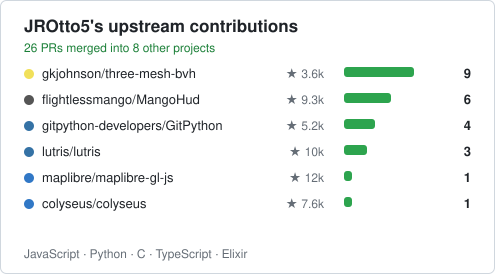</a>
</p>

- **[GitPython](https://github.com/gitpython-developers/GitPython)**: fixed `FetchInfo.note` always coming back empty after `Remote.fetch()`: Git writes the note (for example `(forced update)`) after two spaces, but the result pattern expected four, so the optional group silently matched nothing for years. Two tightened tests fail on the old code and pass with the fix under both the `cli` and `gix` backends. [#2351](https://github.com/gitpython-developers/GitPython/pull/2351), merged.
- **[MangoHud](https://github.com/flightlessmango/MangoHud)**: fixed the FPS limit snapping back to its first value when switching presets: `toggle_preset` rebuilt the limiter and dropped the limit picked with `toggle_fps_limit`. It now keeps that choice when the new preset has the same `fps_limit` list (30 -> 60 -> 30 on master, 30 -> 60 -> 60 with the fix in a glxgears test). [#2203](https://github.com/flightlessmango/MangoHud/pull/2203), merged as submitted, fixes [#2065](https://github.com/flightlessmango/MangoHud/issues/2065).
- **[MangoHud](https://github.com/flightlessmango/MangoHud)**: removed the empty strip under the last row of the `hud_compact` overlay: the window ended a fixed 11 px past the text even with zero padding. It now ends at the last line (plus room for descenders and the outline); the gap under the text went from 4/3/2 px to 0 at font sizes 16/24/64, other layouts unchanged. [#2201](https://github.com/flightlessmango/MangoHud/pull/2201), merged as submitted, fixes [#2111](https://github.com/flightlessmango/MangoHud/issues/2111).
- **[MangoHud](https://github.com/flightlessmango/MangoHud)**: fixed `cpu_custom_temp_sensor=coretemp,temp1` reading the wrong sensor: the prefix match picked `temp10_input` (Core 8 on an i9-14900KF) over the package temperature in `temp1_input`; it now prefers the exact input name. [#2204](https://github.com/flightlessmango/MangoHud/pull/2204), merged.
- **[ProtonUp-Qt](https://github.com/DavidoTek/ProtonUp-Qt)**: the main window now remembers its size, maximized state and (on X11) its position across restarts, closing a feature request open since 2024. Shared save/restore helpers for other windows, a maximized window keeps its normal size, and a stored size larger than the current screen is clamped; the test suite went from 162 to 171. [#669](https://github.com/DavidoTek/ProtonUp-Qt/pull/669), merged as submitted.
- **[three-mesh-bvh](https://github.com/gkjohnson/three-mesh-bvh)**: fixed parallel BVH worker builds of geometry whose arrays are views into a larger buffer (as GLTFLoader produces): the workers got the rest of the buffer as extra vertices, or threw a RangeError when its length wasn't a multiple of 4. A new test matrix field covers it; 81 of its 576 cases failed before the fix, all pass after. [#1002](https://github.com/gkjohnson/three-mesh-bvh/pull/1002), merged.
- **[three-mesh-bvh](https://github.com/gkjohnson/three-mesh-bvh)**: made the BVH worker builds copy the geometry buffers by default instead of transferring them, so the mesh stays readable while a build runs and interleaved or normalized positions now build correctly in the workers (normalized ones used to be read as raw integers); the copy costs 44 ms on a 4M-triangle mesh and transferring stays available as an opt-in. Reworked to the maintainer's design over two review rounds; worker tests cover indexed, non-indexed, interleaved and normalized geometry. [#979](https://github.com/gkjohnson/three-mesh-bvh/pull/979), merged.
- **[three-mesh-bvh](https://github.com/gkjohnson/three-mesh-bvh)**: matched `PointsBVH` and `LineSegmentsBVH` raycasting to three.js r188, which now scales the point/line hit threshold by the object's largest world-space scale; without it the BVH and three.js disagree on hits for non-uniformly scaled objects. Follows my three.js report on the same bug; master fails the 4 new tests under r188. [#983](https://github.com/gkjohnson/three-mesh-bvh/pull/983), merged.
- **[MapLibre GL JS](https://github.com/maplibre/maplibre-gl-js)**: fixed Arabic and Persian map labels looking cut at every letter join when drawn with a thin text halo, a regression from the 5.24.0 single-pass halo speedup; only tiles that contain cursive-script labels go back to a separate halo pass, so Latin-only maps keep the faster path (worker parse bench within noise). New render test fails on main. [#9009](https://github.com/maplibre/maplibre-gl-js/pull/9009), merged, fixes [#8949](https://github.com/maplibre/maplibre-gl-js/issues/8949).
- **[Supavisor](https://github.com/supabase/supavisor)**: made the Supabase connection pooler tell clients when it drops startup options it doesn't pass on to Postgres (for example `options=-c statement_timeout=…`), which used to be ignored silently: one NOTICE lists every unknown option, as the maintainer asked; reworked to his design in review (Elixir). [#1273](https://github.com/supabase/supavisor/pull/1273), merged, fixes [#1272](https://github.com/supabase/supavisor/issues/1272).
- **[three-mesh-bvh](https://github.com/gkjohnson/three-mesh-bvh)**: added compressed WebGPU vertex attribute types (`oct16` normals/tangents, `2x16float` uvs, `4x16float` colors), cutting the path tracer vertex layout from 68 to 36 bytes per vertex; decoded directions within 2e-4 radians in the GPU tests. [#982](https://github.com/gkjohnson/three-mesh-bvh/pull/982), merged.
- **[Lutris](https://github.com/lutris/lutris)**: fixed Wine desktop integration for the Templates folder (open since 2022): new prefixes no longer link it to `~/Templates`, and turning integration on no longer fails with an IndexError on every launch; 4 tests, 3 fail without the fix. [#7010](https://github.com/lutris/lutris/pull/7010), merged.
- **[three-mesh-bvh](https://github.com/gkjohnson/three-mesh-bvh)**: packed the index and vertex attributes into one WebGPU storage buffer, freeing one of the shader's limited storage bindings (the default limit is 8 per stage) for kernels already at the limit, and added a `getTriangleIndices` shader function used by raycasts and closest-point queries; a requested follow-up to #969, written to the maintainer's plan. [#980](https://github.com/gkjohnson/three-mesh-bvh/pull/980), merged.
- **[three-mesh-bvh](https://github.com/gkjohnson/three-mesh-bvh)**: packed WebGPU vertex attributes tightly into one `u32` buffer and added `getVertex`/`getVertexPosition` shader functions; a second UV set used to read zeros from padding, and a position + two UV sets now takes 28 bytes per vertex instead of 48. The maintainer is porting his path tracer to it. [#969](https://github.com/gkjohnson/three-mesh-bvh/pull/969), merged.
- **[colyseus](https://github.com/colyseus/colyseus)**: stopped the matchmaker from telling clients a room was "already full" whenever a seat reservation failed for another reason (a throwing remote room, an IPC timeout on a healthy process, a local throw); the real cause now reaches the client, 3 new MatchMaker tests fail without the fix. [#1001](https://github.com/colyseus/colyseus/pull/1001), merged and released in @colyseus/core 0.18.28.
- **[three-mesh-bvh](https://github.com/gkjohnson/three-mesh-bvh)**: made a failed parallel BVH build reject instead of hanging, which also left the worker stuck for every later build; reworked to the maintainer's single-handler design in review, worker change down to ~25 lines, new WorkerPool tests (2 of 3 fail without the fix). [#963](https://github.com/gkjohnson/three-mesh-bvh/pull/963), merged.
- **[three-mesh-bvh](https://github.com/gkjohnson/three-mesh-bvh)**: made WebGPU geometry packing copy vertex attributes straight from their backing arrays instead of through per-vertex accessors: 2.1x faster for positions and up to 7.2x with normals and UVs on 12.6M vertices, byte-identical output. [#958](https://github.com/gkjohnson/three-mesh-bvh/pull/958), merged.
- **[Lutris](https://github.com/lutris/lutris)**: repaired broken Pango markup that left nine UI strings blank in five translations (Greek, French, Brazilian Portuguese, both Chinese), plus a test that parses every translated markup string. [#7006](https://github.com/lutris/lutris/pull/7006), merged.
- **[Lutris](https://github.com/lutris/lutris)**: stopped a missing Wine version from silently upgrading a game's plain Wine prefix to Proton, a one-way conversion; reworked to the maintainer's narrower rule in review, 7 tests (3 fail without the fix). [#7004](https://github.com/lutris/lutris/pull/7004), merged.
- **[three-mesh-bvh](https://github.com/gkjohnson/three-mesh-bvh)**: fixed WebGPU camera rays losing precision far from the world origin (up to 42 px off at 1080p). [#956](https://github.com/gkjohnson/three-mesh-bvh/pull/956), merged.
- **[MangoHud](https://github.com/flightlessmango/MangoHud)**: added `cpu_max_core_load`, so a single-thread bottleneck shows up next to the averaged CPU load. [#2198](https://github.com/flightlessmango/MangoHud/pull/2198), merged.
- **[colyseus/schema](https://github.com/colyseus/schema)**: found an `ArraySchema.sort()` client desync with a differential fuzzer; co-author of the fix in 5.0.44, with my regression tests in the release ([#250](https://github.com/colyseus/schema/pull/250)). Also reported a `splice()` desync, fixed in 5.0.45 ([#252](https://github.com/colyseus/schema/issues/252)).

**Credited in maintainers' own fixes:** a Lutris bug open for 2½ years, fixed by its maintainer from my diagnosis ("I never figured out what was going on there", [#5258](https://github.com/lutris/lutris/issues/5258)); Janus AudioBridge, where my 22-minute stream test confirmed the sequence-wrap fix before merge ([#3706](https://github.com/meetecho/janus-gateway/pull/3706)); FreeSWITCH, where my test caught a regression in an Opus negotiation change and my case went into its unit tests ([#3064](https://github.com/signalwire/freeswitch/pull/3064)); and Valve's gamescope ([`Reported-by`](https://github.com/ValveSoftware/gamescope/pull/2541#issuecomment-6690538950)).

---

## Activity

<p align="center">
  
</p>
<p align="center">
  
  
</p>

<sub>Many of these PRs are opened by coding agents I orchestrate. Every one gets AI review and a human approval before it merges. Generated from the GitHub API by <a href="tools/gen_stats.py">tools/gen_stats.py</a>.</sub>

---

## How I'd work with your team

- **I write it down first.** Dragon Front has 35 design docs. At work, changes to customer-facing paths start with a short design note and a golden-output diff.
- **I test like a player.** Headless bots play my game and screenshot every match; I'd bring that habit to your QA and perf budgets.
- **I measure before I automate.** Shadow mode, precision targets, then rollout.
- **I work across the whole stack**: rendering and netcode, Postgres and AWS, kernel and driver debugging.
- **I use AI tools with guardrails**, and I can tell you exactly where they help and where they don't.


---

## Dragon Front

<p align="center">
  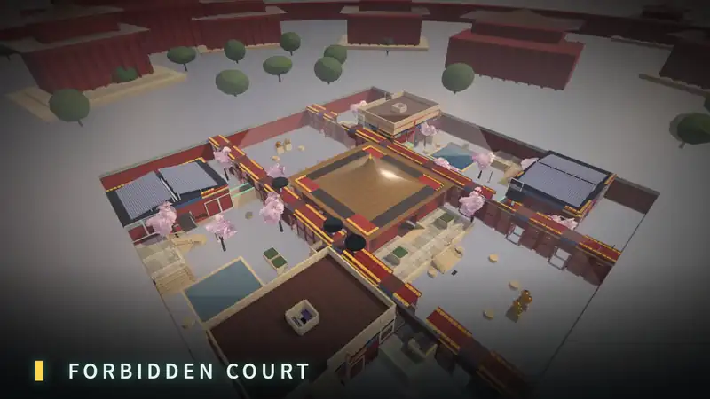
</p>

**A fast, boots-on-the-ground military FPS that runs in the browser.** Jade Dragons vs Crimson Tigers, 2049. It has Steamworks integration, is in pre-release, and its source stays private until launch. There's no engine: Three.js plus plain ES modules, so I own the render loop and the network loop.

| | |
|---|---|
| 📈 **Scale** | **1,190+ commits · 324 modules · 94k lines of JS · 150 test scripts** · 35 design docs (art bible, balance, campaign scripts, store page, release checklist) |
| 🌐 **Netcode** | My own **authoritative Node match server** (~5k lines): binary delta-snapshot codec, client prediction, lag compensation, lobby host hand-off, server browser, parties, spectator/caster mode, bot backfill, and a packaged dedicated server |
| 🎮 **Content** | 10-mission campaign with cutscenes · **20 maps** · 52 weapons · Domination, Hardpoint, S&D, CTF, Gun Game, Infected, Gunfight 2v2 · Ranked seasons · **Dynasty Defense** co-op horde · **Ground War**: 20v20 with bot backfill, five flags, vehicles |
| 🤖 **AI** | Squad-level bot director (attack/defend orders) and per-bot LOD (frustum + distance tiers) for 40-combatant Ground War matches |
| ✨ **Rendering** | Custom post pipeline (GTAO, bloom, SMAA, color grade), procedural PBR textures, HDRI lighting, per-map weather |
| 🕹️ **Platforms** | Gamepad with aim assist and rumble · Steamworks, Workshop and Steam Input · Steam Deck mode · touch controls for phones |
| 🧪 **Quality** | Headless bots that play matches and screenshot them · map validators · perf harnesses · a deterministic trailer pipeline (the clip above is its output) |
| 📜 **Licensing** | Every third-party asset is logged with its source and license, with CC0/CC BY credits in game |

<p align="center">
  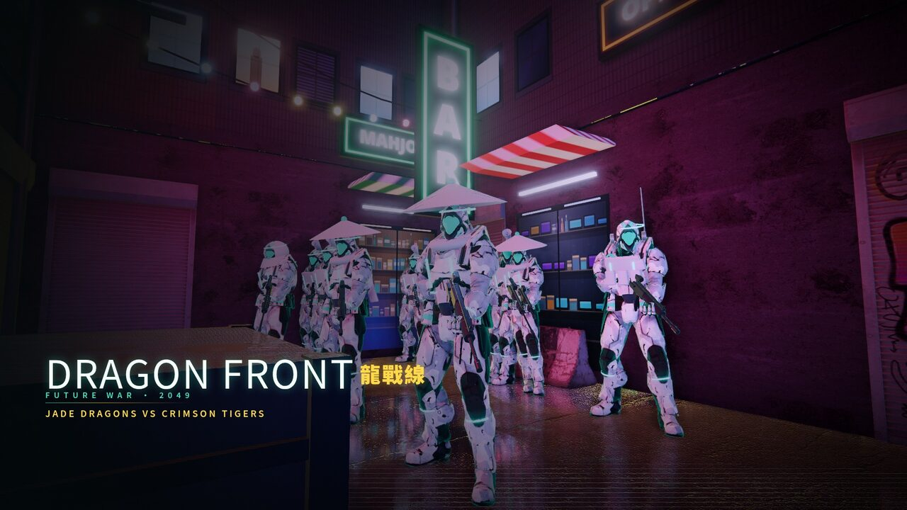
  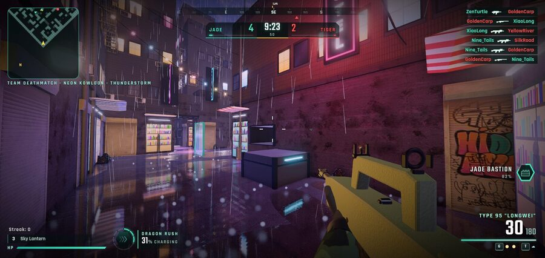
  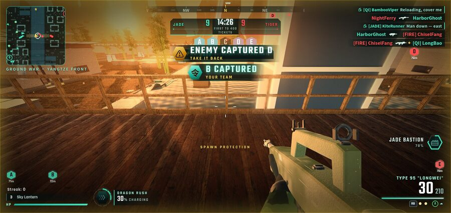
</p>

**→ [Read the engineering case study](case-studies/dragon-front.md)**: the netcode, the bot AI, rendering budgets and automated playtesting. I'm happy to demo it live.

---

## Production engineering

**Day job.** I build and run a production compliance platform end to end: Postgres (Supabase) with the business logic in the database, scheduled and queue-driven AWS Lambda jobs in Python, TypeScript/React clients, and the AI development tooling the team uses to ship it.

<sub>Proprietary work, so no details here. I'm glad to talk about it in person.</sub>

---

## Products

<table>
<tr>
<td width="62%" valign="top">

### 📊 [The Edge Board](https://nfl-edge-kappa.vercel.app) · [source](https://github.com/JROtto5/nfl-edge)
A sports forecasting system for the NFL and college football with a **public, self-grading track record**. It's an installable PWA.
- **~30 measured signals** (weather, role-weighted injuries, line movement, rest, live in-game pace), combined by evidence weight. When signals conflict, the board shows the conflict instead of hiding it.
- **Its own model**: least-squares power ratings blended with a matchup model and adjusted for injuries.
- **Audited record**: every prediction is frozen when published and graded against the final score and closing line, with a per-signal self-audit.
- **It abstains** when no signal clears the threshold, instead of ranking the least-bad option.

<sub>JS · Vercel serverless + cron grading · Vercel Blob · web push · MIT</sub>

</td>
<td width="38%" valign="top">
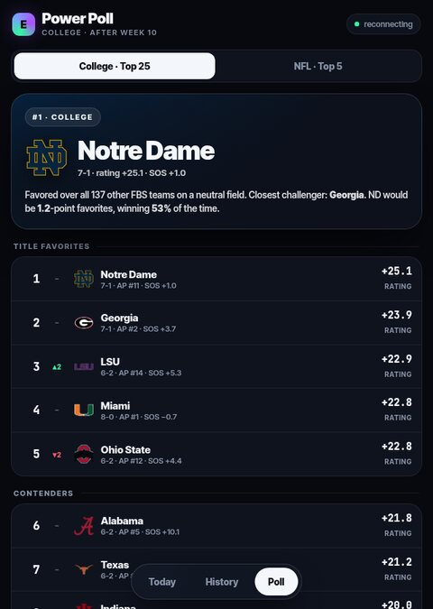
</td>
</tr>
</table>

**🔬 [crucible](#crucible)**: my open-source AI PR reviewer ([details above](#crucible)).

**🃏 [upstream-card](https://github.com/JROtto5/upstream-card)**: a GitHub Action and CLI that turns your merged PRs in other people's projects into a profile card (the one above). It counts public repos only, splits GitHub's 1,000-result search cap into date windows, and has zero dependencies.

**🏈 [Draft War Room](https://github.com/JROtto5/draft-war-room)**: a fantasy-football decision tool. It runs Monte Carlo survival and title odds, builds a start/sit consensus across three providers, and has a waiver radar and trade sims. It's an MIT-licensed, zero-build PWA that auto-deploys to Vercel.

**✂️ Clipper**: paste a video link and get vertical, captioned highlight Shorts. Claude picks the moments from the transcript, FFmpeg renders them, and the YouTube Data API uploads them as drafts. Re-runs are idempotent and cached.

---

## Games & creative code

<table>
<tr>
<td width="50%" valign="top">

### 🔵 [Dot Universe](https://github.com/JROtto5/dot-universe) · [**▶ play**](https://www.dotslayer.live)
Two browser games on one account: **DotSlayer**, a 150-floor roguelike shooter with 6 classes, a boss every 10 floors, challenge modes and global leaderboards, and **Dot Clicker**, an idle empire with prestige. Progress in each one boosts the other.

<a href="https://www.dotslayer.live">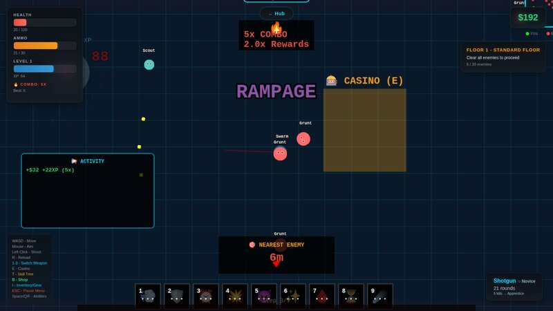</a>

<sub>Next.js 14 · Phaser 3 · Supabase auth, cloud saves, leaderboards</sub>

### 🎰 [NEON SPIN](https://github.com/JROtto5/neon-spin) · [**▶ play**](https://jrotto5.github.io/neon-spin/)
An idle/incremental game in **one self-contained HTML file with no build step**: up to 7 reels, 40 upgrades, 39 achievements, VIP perks and an Ascension prestige layer.

</td>
<td width="50%" valign="top">

### 🎬 LUMEN: a short film rendered from code
A **4-minute animated short** where every frame is drawn in Python (pycairo + numpy, 1080p/24fps). It uses a timeline-driven scene system, synthesized voices, and a mixed score and SFX. A tiny robot lighthouse keeper gives up its own heart to light the lamp.

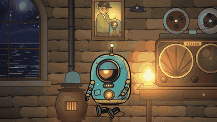
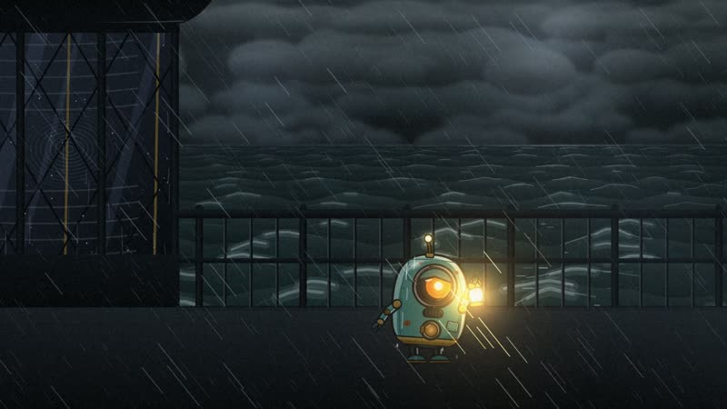

</td>
</tr>
</table>

---

## Linux

### [SITH OS](https://github.com/JROtto5/sith-os): my own Arch Linux distribution
It's built with `archiso`: an installable live ISO with a Calamares graphical installer, **~240 curated packages and 11 custom commands**, themed end to end from bootloader to Plymouth, SDDM, KDE Plasma and the Kitty terminal.

I daily-drive Arch on a 4-monitor RTX 5070 Ti workstation, write my own **Plasma 6 widgets** and **KWin effect patches**, and debug the kernel/driver/compositor stack myself. One example: tracing a multi-monitor lag problem to an nvidia-open driver regression that dropped the GPU's PCIe link to Gen 1.

---
<p align="center">
  <b>Open to product engineering, platform and game dev roles.</b> I'm happy to demo Dragon Front or walk through any architecture above.
</p>
