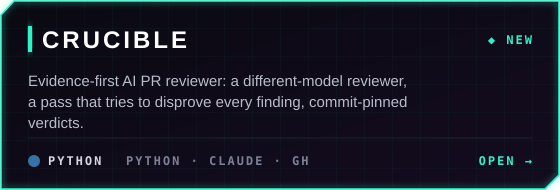
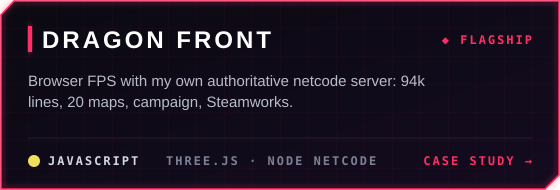
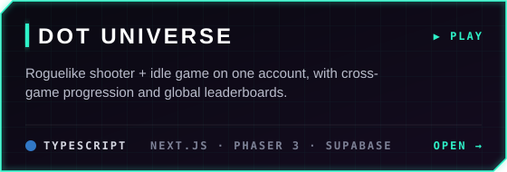
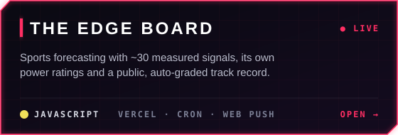
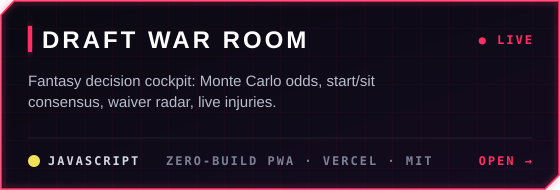
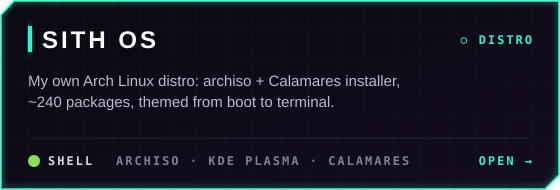
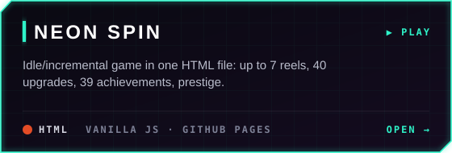

<p align="center">
  
</p>

<p align="center">
  <b>I'm a product engineer who builds production systems end to end: AI dev tooling, data platforms on Postgres and AWS, and the real-time apps on top.</b><br>
  By day I build a production compliance platform and the AI tooling around it. On nights and weekends I'm building a browser FPS with its own authoritative multiplayer server.
</p>

<p align="center">
  <a href="https://www.dotslayer.live"></a>
  <a href="https://jrotto5.github.io/neon-spin/"></a>
  <a href="https://nfl-edge-kappa.vercel.app"></a>
  <a href="https://github.com/JROtto5/sith-os"></a>
</p>

| | |
|---|---|
| **84 reviews · 9 upstream projects** | **[crucible](#crucible)**, the open-source AI PR reviewer I built: its verification pass throws out 45% of the model's own findings before anyone reads them |
| **3,030 PRs · 88% merged** | The past year on GitHub: 6.2k commits across 41 repos, 242 active days |
| **94k lines · 1,190+ commits** | **Dragon Front**: a browser FPS I built from an empty folder, solo, with AI pair-programming under my review |
| **~5k-line authoritative server** | My own Node netcode: binary delta snapshots, client prediction, lag compensation, bot backfill |
| **4 live apps you can open now** | DotSlayer, NEON SPIN, The Edge Board, Draft War Room, plus my own Arch Linux distro |

<p align="center">
  <a href="#crucible"></a>
  <a href="#activity"></a>
  <a href="#how-id-work-with-your-team"></a>
  <a href="#dragon-front"></a>
  <a href="#production-engineering"></a>
  <a href="#products"></a>
  <a href="#games--creative-code"></a>
  <a href="#linux"></a>
</p>


<p align="center">
  <a href="https://github.com/JROtto5/crucible"></a>
  <a href="case-studies/dragon-front.md"></a>
  <a href="https://github.com/JROtto5/dot-universe"></a>
  <a href="https://github.com/JROtto5/nfl-edge"></a>
  <a href="https://github.com/JROtto5/draft-war-room"></a>
  <a href="https://github.com/JROtto5/sith-os"></a>
  <a href="https://github.com/JROtto5/neon-spin"></a>
</p>

## crucible

**[crucible](https://github.com/JROtto5/crucible)** is the AI code reviewer I built and maintain. Every open-source PR I send goes through it first; it never posts, I submit. MIT, Python standard library only.

| | |
|---|---|
| **84 reviews** | across 9 upstream projects, including Valve's gamescope, three.js, Supabase, MangoHud and Lutris |
| **$0.78** | average cost per review |
| **45% dropped** | of 277 model findings, by its own verification pass |
| **24 of 30 held up** | of the findings authors have answered so far (fixed or deferred, not refuted) |

**How it works.** The project's own build and tests run first. A model different from the one that wrote the change reviews it, and each finding must say what observation would prove it wrong. A verification pass then tries to prove exactly that, and only survivors are reported. Verdicts are pinned to one commit, the author answers every finding, and it learns each project's house style from its merged PRs.

**A recent catch.** It flagged a signal race in Valve's gamescope reaper. The same window was in another contributor's fix for that bug; they reproduced it under gdb, fixed it and credited me ([`Reported-by`](https://github.com/ValveSoftware/gamescope/pull/2541#issuecomment-6690538950)).

```sh
pipx install git+https://github.com/JROtto5/crucible
```

## Selected open-source contributions

- **[three-mesh-bvh](https://github.com/gkjohnson/three-mesh-bvh)**: fixed WebGPU camera rays losing precision far from the world origin (up to 42 px off at 1080p). [#956](https://github.com/gkjohnson/three-mesh-bvh/pull/956), merged.
- **[MangoHud](https://github.com/flightlessmango/MangoHud)**: added `cpu_max_core_load`, so a single-thread bottleneck shows up next to the averaged CPU load. [#2198](https://github.com/flightlessmango/MangoHud/pull/2198), merged.
- **[colyseus/schema](https://github.com/colyseus/schema)**: found an `ArraySchema.sort()` client desync with a differential fuzzer; co-author of the fix in 5.0.44, with my regression tests in the release ([#250](https://github.com/colyseus/schema/pull/250)). Also reported a `splice()` desync, fixed in 5.0.45 ([#252](https://github.com/colyseus/schema/issues/252)).

---

## Activity

<p align="center">
  
</p>
<p align="center">
  
  
</p>

<sub>Many of these PRs are opened by coding agents I orchestrate. Every one gets AI review and a human approval before it merges. Generated from the GitHub API by <a href="tools/gen_stats.py">tools/gen_stats.py</a>.</sub>

---

## How I'd work with your team

- **I write it down first.** Dragon Front has 35 design docs. At work, changes to customer-facing paths start with a short design note and a golden-output diff.
- **I test like a player.** Headless bots play my game and screenshot every match; I'd bring that habit to your QA and perf budgets.
- **I measure before I automate.** Shadow mode, precision targets, then rollout.
- **I work across the whole stack**: rendering and netcode, Postgres and AWS, kernel and driver debugging.
- **I use AI tools with guardrails**, and I can tell you exactly where they help and where they don't.


---

## Dragon Front

<p align="center">
  
</p>

**A fast, boots-on-the-ground military FPS that runs in the browser.** Jade Dragons vs Crimson Tigers, 2049. It has Steamworks integration, is in pre-release, and its source stays private until launch. There's no engine: Three.js plus plain ES modules, so I own the render loop and the network loop.

| | |
|---|---|
| 📈 **Scale** | **1,190+ commits · 324 modules · 94k lines of JS · 150 test scripts** · 35 design docs (art bible, balance, campaign scripts, store page, release checklist) |
| 🌐 **Netcode** | My own **authoritative Node match server** (~5k lines): binary delta-snapshot codec, client prediction, lag compensation, lobby host hand-off, server browser, parties, spectator/caster mode, bot backfill, and a packaged dedicated server |
| 🎮 **Content** | 10-mission campaign with cutscenes · **20 maps** · 52 weapons · Domination, Hardpoint, S&D, CTF, Gun Game, Infected, Gunfight 2v2 · Ranked seasons · **Dynasty Defense** co-op horde · **Ground War**: 20v20 with bot backfill, five flags, vehicles |
| 🤖 **AI** | Squad-level bot director (attack/defend orders) and per-bot LOD (frustum + distance tiers) for 40-combatant Ground War matches |
| ✨ **Rendering** | Custom post pipeline (GTAO, bloom, SMAA, color grade), procedural PBR textures, HDRI lighting, per-map weather |
| 🕹️ **Platforms** | Gamepad with aim assist and rumble · Steamworks, Workshop and Steam Input · Steam Deck mode · touch controls for phones |
| 🧪 **Quality** | Headless bots that play matches and screenshot them · map validators · perf harnesses · a deterministic trailer pipeline (the clip above is its output) |
| 📜 **Licensing** | Every third-party asset is logged with its source and license, with CC0/CC BY credits in game |

<p align="center">
  
  
  
</p>

**→ [Read the engineering case study](case-studies/dragon-front.md)**: the netcode, the bot AI, rendering budgets and automated playtesting. I'm happy to demo it live.

---

## Production engineering

**Day job.** I build and run a production compliance platform end to end: Postgres (Supabase) with the business logic in the database, scheduled and queue-driven AWS Lambda jobs in Python, TypeScript/React clients, and the AI development tooling the team uses to ship it.

<sub>Proprietary work, so no details here. I'm glad to talk about it in person.</sub>

---

## Products

<table>
<tr>
<td width="62%" valign="top">

### 📊 [The Edge Board](https://nfl-edge-kappa.vercel.app) · [source](https://github.com/JROtto5/nfl-edge)
A sports forecasting system for the NFL and college football with a **public, self-grading track record**. It's an installable PWA.
- **~30 measured signals** (weather, role-weighted injuries, line movement, rest, live in-game pace), combined by evidence weight. When signals conflict, the board shows the conflict instead of hiding it.
- **Its own model**: least-squares power ratings blended with a matchup model and adjusted for injuries.
- **Audited record**: every prediction is frozen when published and graded against the final score and closing line, with a per-signal self-audit.
- **It abstains** when no signal clears the threshold, instead of ranking the least-bad option.

<sub>JS · Vercel serverless + cron grading · Vercel Blob · web push · MIT</sub>

</td>
<td width="38%" valign="top">

</td>
</tr>
</table>

**🔬 [crucible](#crucible)**: my open-source AI PR reviewer ([details above](#crucible)).

**🏈 [Draft War Room](https://github.com/JROtto5/draft-war-room)**: a fantasy-football decision tool. It runs Monte Carlo survival and title odds, builds a start/sit consensus across three providers, and has a waiver radar and trade sims. It's an MIT-licensed, zero-build PWA that auto-deploys to Vercel.

**✂️ Clipper**: paste a video link and get vertical, captioned highlight Shorts. Claude picks the moments from the transcript, FFmpeg renders them, and the YouTube Data API uploads them as drafts. Re-runs are idempotent and cached.

---

## Games & creative code

<table>
<tr>
<td width="50%" valign="top">

### 🔵 [Dot Universe](https://github.com/JROtto5/dot-universe) · [**▶ play**](https://www.dotslayer.live)
Two browser games on one account: **DotSlayer**, a 150-floor roguelike shooter with 6 classes, a boss every 10 floors, challenge modes and global leaderboards, and **Dot Clicker**, an idle empire with prestige. Progress in each one boosts the other.

<a href="https://www.dotslayer.live"></a>

<sub>Next.js 14 · Phaser 3 · Supabase auth, cloud saves, leaderboards</sub>

### 🎰 [NEON SPIN](https://github.com/JROtto5/neon-spin) · [**▶ play**](https://jrotto5.github.io/neon-spin/)
An idle/incremental game in **one self-contained HTML file with no build step**: up to 7 reels, 40 upgrades, 39 achievements, VIP perks and an Ascension prestige layer.

</td>
<td width="50%" valign="top">

### 🎬 LUMEN: a short film rendered from code
A **4-minute animated short** where every frame is drawn in Python (pycairo + numpy, 1080p/24fps). It uses a timeline-driven scene system, synthesized voices, and a mixed score and SFX. A tiny robot lighthouse keeper gives up its own heart to light the lamp.


</td>
</tr>
</table>

---

## Linux

### [SITH OS](https://github.com/JROtto5/sith-os): my own Arch Linux distribution
It's built with `archiso`: an installable live ISO with a Calamares graphical installer, **~240 curated packages and 11 custom commands**, themed end to end from bootloader to Plymouth, SDDM, KDE Plasma and the Kitty terminal.

I daily-drive Arch on a 4-monitor RTX 5070 Ti workstation, write my own **Plasma 6 widgets** and **KWin effect patches**, and debug the kernel/driver/compositor stack myself. One example: tracing a multi-monitor lag problem to an nvidia-open driver regression that dropped the GPU's PCIe link to Gen 1.

---
<p align="center">
  <b>Open to product engineering, platform and game dev roles.</b> I'm happy to demo Dragon Front or walk through any architecture above.
</p>
