

  

  <b>I build real-time games and production data systems end to end: netcode and rendering, Postgres and AWS, down to the Linux kernel when it breaks.</b> 
  By day I build a production compliance platform and the AI review tooling around it. On nights and weekends I'm building a browser FPS with its own authoritative multiplayer server.

  
  
  
  

| | |
|---|---|
| **75k+ lines · 1,190+ commits** | **Dragon Front**: a browser FPS I built solo from an empty folder |
| **~5k-line authoritative server** | My own Node netcode: binary delta snapshots, client prediction, lag compensation, host migration |
| **~4–6 min PR → verdict** | **BLAZE 2**, the AI code reviewer I built and run: thousands of reviews a month across a few dozen repos ([case study](case-studies/blaze-2.md)) |
| **25+ Lambda jobs in production** | Supabase/Postgres business logic, customer reporting, an MCP server for AI agents |
| **3,030 PRs · 88% merged** | The past year on GitHub: 6.2k commits across 41 repos, 242 active days |
| **4 live apps you can open now** | DotSlayer, NEON SPIN, The Edge Board, Draft War Room, plus my own Arch Linux distro |

  <a href="#dragon-front">Dragon Front</a> ·
  <a href="#production-engineering">Production engineering</a> ·
  <a href="#selected-engineering-decisions">Engineering decisions</a> ·
  <a href="#products">Products</a> ·
  <a href="#linux">Linux</a> ·
  <a href="#games--creative-code">Games &amp; creative code</a> ·
  <a href="#activity">Activity</a>

---

## Dragon Front

  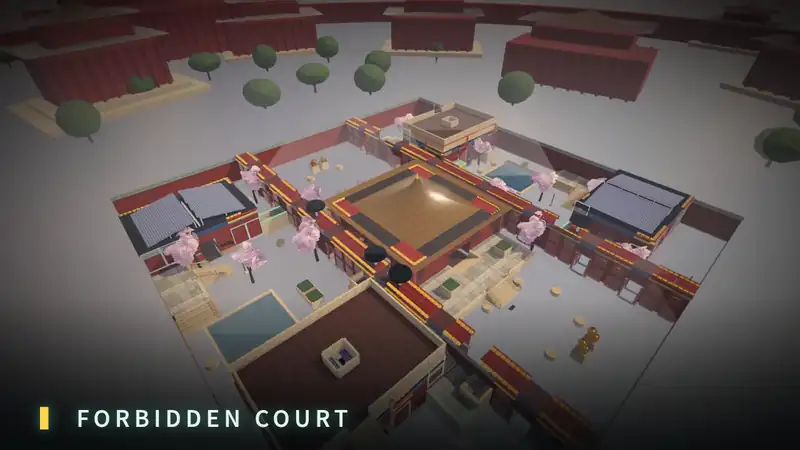

**A fast, boots-on-the-ground military FPS that runs in the browser.** Jade Dragons vs Crimson Tigers, 2049. It has Steamworks integration, is in pre-release, and its source stays private until launch. There's no engine: Three.js plus plain ES modules, so I own the render loop and the network loop.

| | |
|---|---|
| 📈 **Scale** | **1,190+ commits · 250+ modules · 75k+ lines of JS** · 30+ design docs (art bible, balance, campaign scripts, store page, release checklist) |
| 🌐 **Netcode** | My own **authoritative Node match server** (~5k lines): binary delta-snapshot codec, client prediction, lag compensation, host migration, server browser, parties, spectator/caster mode, bot backfill, and a packaged dedicated server |
| 🎮 **Content** | 10-mission campaign with cutscenes · **17 maps** · Domination, Hardpoint, S&D, CTF, Gun Game, Infected, Gunfight 2v2 · Ranked seasons · **Dynasty Defense** co-op horde · **Ground War**: 20v20 with bot backfill, five flags, vehicles |
| 🤖 **AI** | Squad-level bot director (attack/defend orders) and per-bot LOD (frustum + distance tiers), frame-time budgeted for 40 combatants |
| ✨ **Rendering** | Custom post pipeline (GTAO, bloom, SMAA, color grade), procedural PBR textures, HDRI lighting, per-map weather |
| 🕹️ **Platforms** | Gamepad with aim assist and rumble · Steamworks, Workshop and Steam Input · Steam Deck mode · touch controls for phones |
| 🧪 **Quality** | Headless bots that play matches and screenshot them · map validators · perf harnesses · a deterministic trailer pipeline (the clip above is its output) |
| 📜 **Licensing** | Every third-party asset is logged with its source and license, with CC0/CC BY credits in game |

  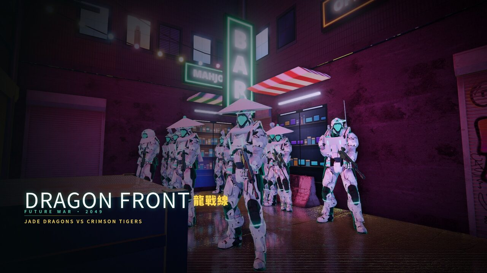
  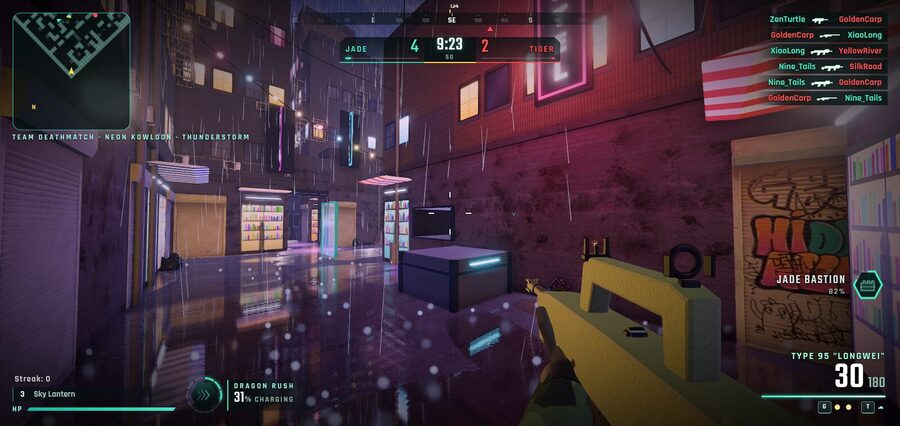
  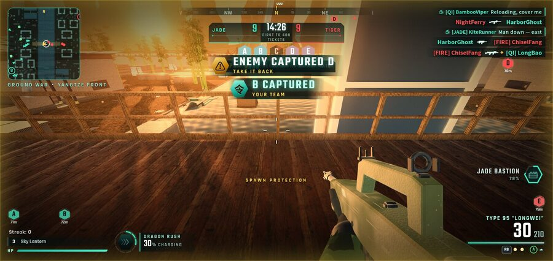

**→ [Read the engineering case study](case-studies/dragon-front.md)**: the netcode, the bot AI, rendering budgets and automated playtesting. I'm happy to demo it live.

---

## Production engineering

**Day job.** I build and run a production compliance and remediation platform, and the AI development tooling around it.

- **Turned a spreadsheet-and-script operation into a production platform.** Postgres (Supabase) holds the business logic in SECURITY DEFINER RPCs behind row-level security. A fleet of **25+ scheduled and queue-driven AWS Lambda jobs** (Python, SAM, SQS, EventBridge) does the work, and thin TypeScript/React clients render what the database decides.
- **Built [BLAZE 2](case-studies/blaze-2.md), an AI code reviewer.** It takes PRs and design plans to "safe to approve" in **~4–6 minutes**, at thousands of reviews a month. It runs parallel reviewers and a verification pass, and every finding must state what would disprove it. Verdicts are tied to the exact head commit, and an approval gate makes sure **a human always approves**. It deploys itself with canary reviews and automatic rollback.
- **Built the orchestration for parallel coding agents**: isolated clones, a capacity-guarded launch queue, stall detection, merge pipelines and daily ticket reconciliation. Every change goes through the AI review gate and human approval before it merges.
- **Shipped customer-facing reporting end to end**: per-customer email jobs, a partner push API and web dashboards. They all read **one shared classifier**, so every surface tells the customer the same thing.
- **Built a live event pipeline** that gets flag events to downstream systems in about 3 minutes. A minute-by-minute safety-net feed ran in shadow first, at over 99% agreement, before go-live.
- **Built the data layer**: backtested prediction models with calibrated confidence intervals, nightly scoring and weekly recalibration with drift alarms, and an **MCP server** that gives AI agents read-only reporting access with scoped keys.
- **Hardened reliability**: default-deny grants, migration gates that replay every schema change in Docker, CI drift guards, paging alarms, and golden-output diff tests before any change to a customer-facing path.

Proprietary work, so no code or customer details here. I'm glad to walk through the architecture.

---

## Selected engineering decisions

**Authoritative server, not peer-to-peer** *(Dragon Front)*. Browser clients can't be trusted, and a P2P host has an advantage that ruins ranked play. The server owns the game state and sends binary delta snapshots instead of JSON. Clients predict locally while the server rewinds time to validate hits. The trade-off: I run servers and handle host migration myself.

**Business logic in Postgres, not in the clients** *(day job)*. Emails, the partner API and dashboards all call the same RPCs, so they can't disagree. SQL is harder to unit-test, so every migration is replayed in Docker in CI before it ships.

**Shadow mode before automation** *(day job)*. Every risky automation first records what it *would* do next to the human decision. I turn it on only after its precision is measured.

**Make the AI show its work in a form it can lose** *(BLAZE 2)*. A finding has to say what observation would prove it wrong, then survive a verification pass. Authors refute findings with evidence, so false positives become a number I can measure and drive down.

**Freeze predictions at publish time** *(The Edge Board)*. A forecasting system is only credible if it can't revise history. Every call is stored when it appears and graded against the final result and the closing line, and per-signal hit rates are public, misses included.

---

## Products

<table>
<tr>
<td width="62%" valign="top">

### 📊 [The Edge Board](https://nfl-edge-kappa.vercel.app) · [source](https://github.com/JROtto5/nfl-edge)
A sports forecasting system for the NFL and college football with a **public, self-grading track record**. It's an installable PWA.
- **~30 measured signals** (weather, role-weighted injuries, line movement, rest, live in-game pace), combined by evidence weight. When signals conflict, the board shows the conflict instead of hiding it.
- **Its own model**: least-squares power ratings blended with a matchup model and adjusted for injuries.
- **Audited record**: every prediction is frozen when published and graded against the final score and closing line, with a per-signal self-audit.
- **It abstains** when no signal clears the threshold, instead of ranking the least-bad option.

JS · Vercel serverless + cron grading · Vercel Blob · web push · MIT

</td>
<td width="38%" valign="top">
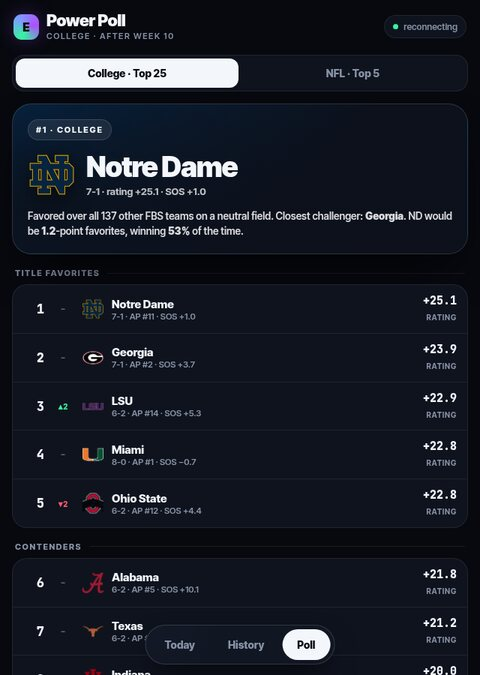
</td>
</tr>
</table>

**🏈 [Draft War Room](https://github.com/JROtto5/draft-war-room)**: a fantasy-football decision tool. It runs Monte Carlo survival and title odds, builds a start/sit consensus across three providers, and has a waiver radar and trade sims. It's an MIT-licensed, zero-build PWA that auto-deploys to Vercel.

**✂️ Clipper**: paste a video link and get vertical, captioned highlight Shorts. Claude picks the moments from the transcript, FFmpeg renders them, and the YouTube Data API uploads them as drafts. Re-runs are idempotent and cached.

---

## Linux

### [SITH OS](https://github.com/JROtto5/sith-os): my own Arch Linux distribution
It's built with `archiso`: an installable live ISO with a Calamares graphical installer, **~240 curated packages and 11 custom commands**, themed end to end from bootloader to Plymouth, SDDM, KDE Plasma and the Kitty terminal.

I daily-drive Arch on a 4-monitor RTX 5070 Ti workstation, write my own **Plasma 6 widgets** and **KWin effect patches**, and debug the kernel/driver/compositor stack myself. One example: tracing a multi-monitor lag problem to an nvidia-open driver regression that dropped the GPU's PCIe link to Gen 1.

---

## Games & creative code

<table>
<tr>
<td width="50%" valign="top">

### 🔵 [Dot Universe](https://github.com/JROtto5/dot-universe) · [**▶ play**](https://www.dotslayer.live)
Two browser games on one account: **DotSlayer**, a 150-floor roguelike shooter with 6 classes, a boss every 10 floors, challenge modes and global leaderboards, and **Dot Clicker**, an idle empire with prestige. Progress in each one boosts the other.

<a href="https://www.dotslayer.live">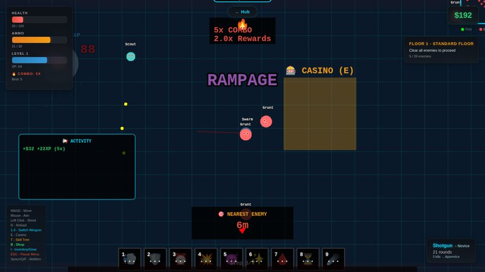</a>

Next.js 14 · Phaser 3 · Supabase auth, cloud saves, leaderboards

### 🎰 [NEON SPIN](https://github.com/JROtto5/neon-spin) · [**▶ play**](https://jrotto5.github.io/neon-spin/)
An idle/incremental game in **one self-contained HTML file with no build step**: up to 7 reels, 40 upgrades, 39 achievements, VIP perks and an Ascension prestige layer.

</td>
<td width="50%" valign="top">

### 🎬 LUMEN: a short film rendered from code
A **4-minute animated short** where every frame is drawn in Python (pycairo + numpy, 1080p/24fps). It uses a timeline-driven scene system, synthesized voices, and a mixed score and SFX. A tiny robot lighthouse keeper gives up its own heart to light the lamp.

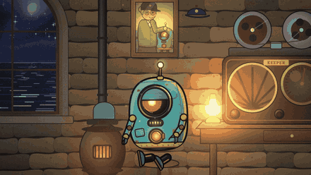
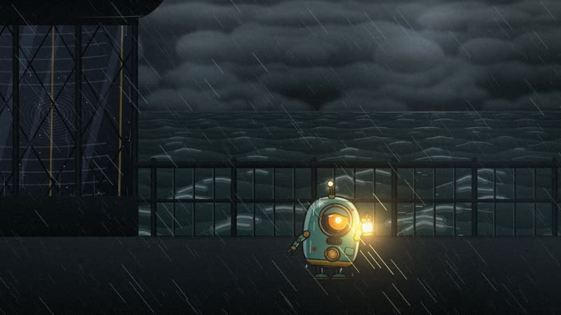

</td>
</tr>
</table>

---

## Activity

  

  
  

Many of these PRs are opened by coding agents I orchestrate. Every one goes through the BLAZE 2 review gate and a human approval before it merges. Generated from the GitHub API by <a href="tools/gen_stats.py">tools/gen_stats.py</a>.

---

## How I'd work with your team

- **I write it down first.** Dragon Front has 30+ design docs. At work, changes to customer-facing paths start with a short design note and a golden-output diff.
- **I test like a player.** Headless bots play my game and screenshot every match; I'd bring that habit to your QA and perf budgets.
- **I measure before I automate.** Shadow mode, precision targets, then rollout.
- **I work across the whole stack**: rendering and netcode, Postgres and AWS, kernel and driver debugging.
- **I use AI tools with guardrails**, and I can tell you exactly where they help and where they don't.

  <b>Open to game dev · product engineering · Linux/infra roles.</b> I'm happy to demo Dragon Front or walk through any architecture above.

