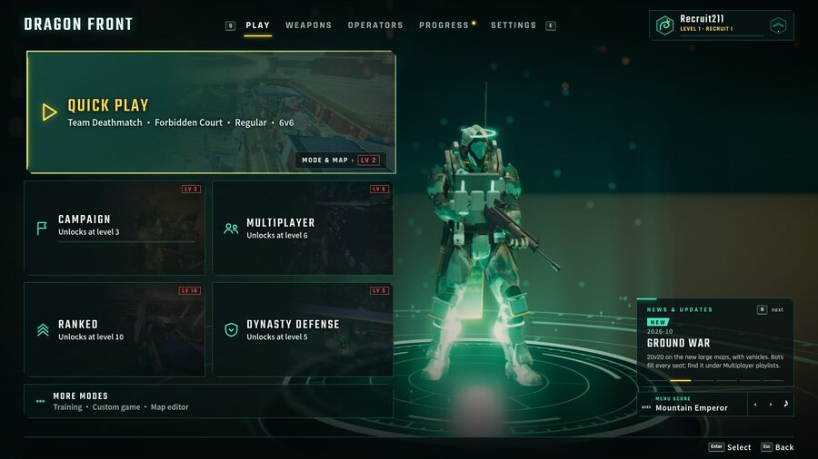

<p align="center">
  
</p>

<p align="center">
  <b>I build things people actually use and games I actually want to play.</b><br>
  3D browser shooters · live data products · a custom Linux distro · a short film rendered entirely from code.
</p>

<p align="center">
  
  
  
  
  
  
  
  
  
  
  
  
</p>

---

## 🐉 Flagship: Dragon Front

<p align="center">
  
</p>

**A Modern Warfare-style FPS that runs in the browser. I designed and built it from an empty folder, and I'm aiming it at Steam.**
Jade Dragons vs Crimson Tigers, 2049. Three.js plus plain ES modules, **no build step**, no engine.

| | |
|---|---|
| 🎮 **Modes** | Campaign · multiplayer playlists · Ranked · **Dynasty Defense** (horde) · **Ground War**: 20v20, five flags, squads, hover-APCs |
| 🔫 **Arsenal** | 28 guns · gunsmith with attachments and camos · classes · perks · killstreaks (Sky Lantern, Dragon's Breath, guided Dragon Missile) · 40 levels plus prestige |
| 🤖 **AI** | Squad-level bot director (attack/defend orders) · per-bot LOD (frustum + distance tiers) so 40 fighters keep the frame rate up |
| ✨ **Rendering** | Custom post pipeline (GTAO, bloom, SMAA, color grade) · procedural PBR textures · HDRI lighting · per-map weather (thunderstorms, blossom storms) |
| 🕹️ **Input** | Full gamepad support with aim assist and rumble · keyboard lock for real PC controls · Steam Deck pass |
| 🧪 **Tooling** | Headless drive/screenshot bots, map validators and perf harnesses that measure 40-combatant frame times |
| 📈 **Scale** | **1,190+ commits · 250+ modules · 75k+ lines of JS** · 30+ design docs (art bible, balance, campaign scripts, release checklist) |

<p align="center">
  
  
  
</p>

<sub>🔒 Source is private while it heads to Steam. I'm happy to demo it live or walk through the code.</sub>

---

## 🚀 Products

| Project | What it is | Stack |
|---|---|---|
| 📊 **[The Edge Board](https://nfl-edge-kappa.vercel.app)** 🔒 | Live NFL + college football analytics board. It runs **~30 measured signals** (weather, role-weighted injuries, line movement, live in-game pace) through weighted stacking, builds its own Massey-style power ratings and sizes stakes with quarter-Kelly. It keeps an **honest track record**: every call is frozen when it appears and graded at the final, with closing-line value and a per-signal self-audit. When nothing qualifies, it says "nothing worth betting". | JS · Vercel serverless · installable PWA |
| 🏈 **[Draft War Room](https://github.com/JROtto5/draft-war-room)** · [live](https://draft-war-room-chi.vercel.app) | Superflex fantasy draft cockpit: Monte Carlo survival odds, live ESPN injuries, Sleeper sync, tiers, mocks and a panic button. | Static PWA, zero build |
| ✂️ **Clipper** 🔒 | Paste a video link and get back vertical, captioned highlight Shorts. Claude picks the moments from the transcript, FFmpeg renders them, and the YouTube API uploads them as drafts. Cached and re-runnable, and it runs on an autopilot timer. | Python · Claude API · FFmpeg · YouTube Data API |
| 🏢 **Day job** | Production compliance and remediation tooling: customer-facing dashboards, reporting pipelines, AWS SAM services and Postgres data packages. | Python · TypeScript · AWS · Postgres |

---

## 🐧 Linux

### [SITH OS: *The Dark Side of Linux*](https://github.com/JROtto5/sith-os)
My own **Arch Linux distribution**, built with `archiso`: an installable live ISO with a Calamares graphical installer, **~190 curated packages, 178 config files and 10 custom commands**.
Themed end to end: GRUB → Plymouth → SDDM → KDE Plasma → Kitty, plus four named virtual desktops (KORRIBAN, MALACHOR, DROMUND, EXEGOL).

I daily-drive Arch on a 4-monitor RTX 5070 Ti rig and write my own **Plasma 6 widgets** (a custom system-stats plasmoid that replaced conky) and **KWin effect patches**. I also debug the kernel/driver/compositor stack when it breaks, and on bleeding-edge NVIDIA it breaks.

---

## 🎨 Games & Fun Projects

<table>
<tr>
<td width="50%" valign="top">

### 🎬 LUMEN: a short film written in Python
A **4-minute animated short** where every frame comes from code (pycairo + numpy, 1080p/24fps). It has a timeline-driven scene system, generated dialogue, a mixed score and SFX, and subtitles. A tiny robot lighthouse keeper gives up its own heart to light the lamp.


</td>
<td width="50%" valign="top">

### 🎰 [NEON SPIN](https://github.com/JROtto5/neon-spin)
A neon idle slot-machine empire: 3→5 animated reels, a luck system, 13 generators, 30+ upgrades and 30+ achievements. **One self-contained HTML file, zero dependencies.**

### ⛏️ Minecraft modding
**[Cyclea](https://github.com/JROtto5/cyclea)** is a Fabric 26.2 client mod, and its repo also documents how to build Fabric mods **without Loom**. **[OttoPack](https://github.com/JROtto5/ottopack)** is the exploration and performance modpack built around it.


</td>
</tr>
</table>

---

## ⚡ How I work

```yaml
ships: fast. Plain modules, no build step unless one earns its place
tests: bots that play my game and screenshot it so I don't ship blind
data:  if a number is on screen, you can see the sample behind it
ai:    I orchestrate parallel coding agents as a daily workflow, not a novelty
linux: when the driver breaks, I'm the one reading dmesg
```

<p align="center">
  
</p>

<!-- CONTACT: add your LinkedIn / email / portfolio link here before publishing -->
