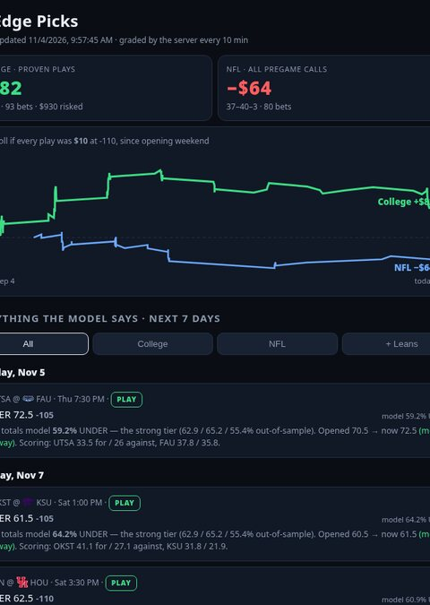
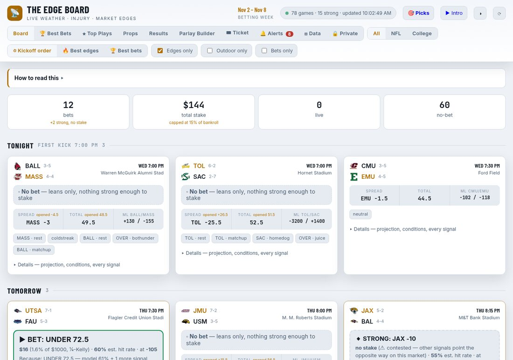
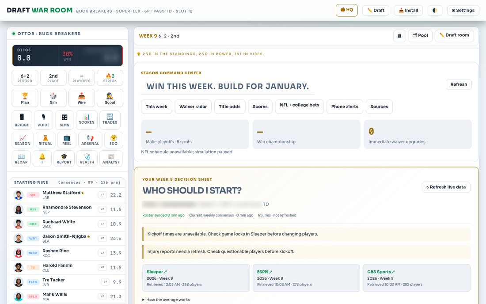
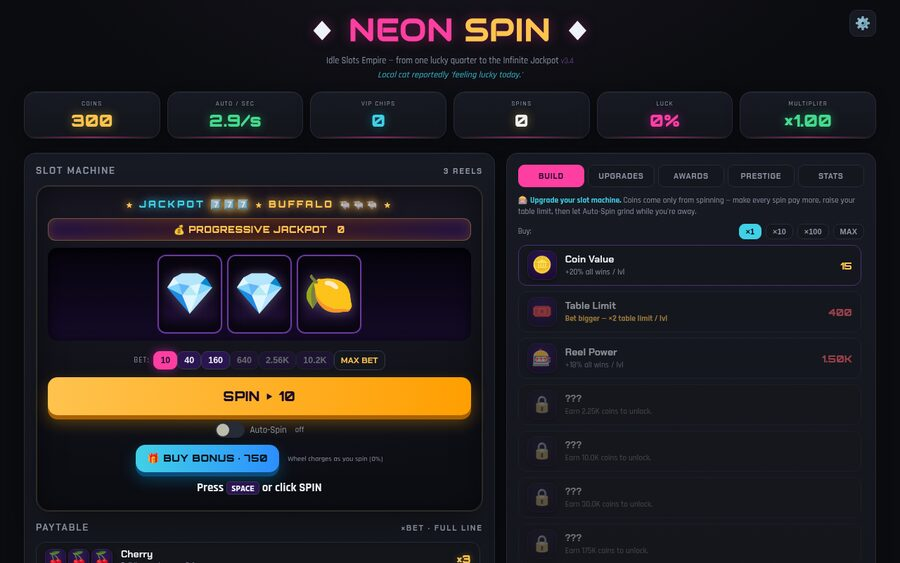
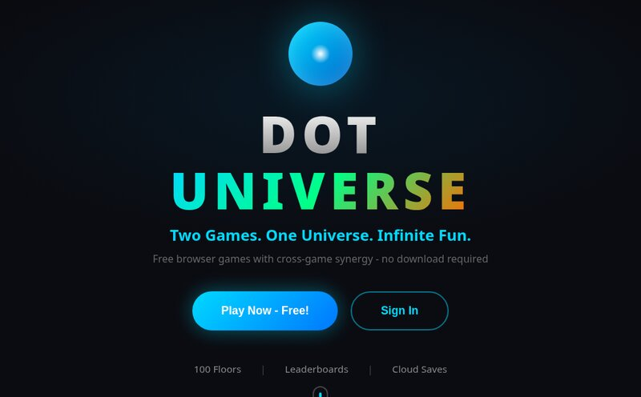

<p align="center">
  
</p>

<p align="center">
  <b>I build games I actually want to play and products people actually use, and I finish them.</b><br>
  A 75k-line 3D shooter with its own netcode · live analytics apps · production cloud platforms · my own Linux distro · a short film rendered entirely from code.
</p>

<p align="center">
  <a href="#-flagship-dragon-front">🐉 Dragon Front</a> ·
  <a href="#-products">🚀 Products</a> ·
  <a href="#-production-engineering-day-job">🏢 Day Job</a> ·
  <a href="#-linux">🐧 Linux</a> ·
  <a href="#-games--creative-code">🎨 Games & Creative Code</a> ·
  <a href="#-how-i-work">⚡ How I Work</a>
</p>

<p align="center">
  <a href="https://jrotto5.github.io/neon-spin/"></a>
  <a href="https://www.dotslayer.live"></a>
  <a href="https://nfl-edge-kappa.vercel.app"></a>
  <a href="https://github.com/JROtto5/sith-os"></a>
</p>

<p align="center">
  
  
  
  
  
  
  
  
  
  
  
</p>

---

## 🐉 Flagship: Dragon Front

<p align="center">
  
</p>

**A Modern Warfare-style FPS that runs in the browser. I designed and built it from an empty folder, and I'm aiming it at Steam.**
Jade Dragons vs Crimson Tigers, 2049. Three.js plus plain ES modules, **no build step**, no engine.

| | |
|---|---|
| 🎮 **Modes** | 10-mission story **campaign** with cutscenes · Domination, Hardpoint, S&D, CTF, Gun Game, Infected, Gunfight 2v2 · **Ranked** seasons · **Dynasty Defense** co-op horde with Titan bosses · **Ground War**: 20v20, five flags, vehicles |
| 🌐 **Online** | My own **authoritative Node match server** (5k lines): binary delta-snapshot netcode, client prediction and lag compensation, host migration, server browser, parties, spectator/caster mode, bot backfill and a packaged dedicated server |
| 🗺️ **World** | **17 maps** (Forbidden Court, Neon Kowloon, Great Wall Pass, Yangtze Front…) built for boost movement and verticality |
| 🔫 **Arsenal** | 28 guns · gunsmith with attachments and camos · classes · perks · killstreaks (Sky Lantern, Dragon's Breath, guided Dragon Missile) · 40 levels plus prestige |
| 🤖 **AI** | Squad-level bot director (attack/defend orders) · per-bot LOD (frustum + distance tiers) so 40 fighters keep the frame rate up |
| ✨ **Rendering** | Custom post pipeline (GTAO, bloom, SMAA, color grade) · procedural PBR textures · HDRI lighting · per-map weather (thunderstorms, blossom storms) |
| 🕹️ **Platforms** | Full gamepad support with aim assist and rumble · Steamworks, Workshop and Steam Input wired up · Steam Deck mode · touch controls for phones |
| 🧪 **Quality** | Headless bots that play matches and screenshot them · map validators · perf harnesses that measure 40-combatant frame times · a tracked bug list and release checklist |
| 📜 **Licensing** | Every third-party asset is logged with its source and license (CC0 / CC BY with in-game credits); procedural or first-party art where no clean source existed |
| 📈 **Scale** | **1,190+ commits · 250+ modules · 75k+ lines of JS** · 30+ design docs (art bible, balance, campaign scripts, store page) |

<p align="center">
  
  
  
  
</p>

<sub>🎥 The trailer above is captured by the game's own scripted camera pipeline, rendered frame by frame from live bot matches. 🔒 Source is private while it heads to Steam; I'm happy to demo it live or walk through the architecture.</sub>

---

## 🚀 Products

<table>
<tr>
<td width="62%" valign="top">

### 📊 [The Edge Board](https://nfl-edge-kappa.vercel.app) · `live` · [source](https://github.com/JROtto5/nfl-edge)
A live NFL + college football analytics app, installable on your phone.
- **~30 measured signals**: weather, role-weighted injuries, line movement, rest, live in-game pace vs the live line
- **Weighted stacking**: agreeing signals are scored by evidence weight, and conflicting ones are shown, never hidden
- **Its own model**: Massey-style power ratings blended with a matchup model and adjusted for injuries
- **Honest track record**: every call is frozen the moment it appears and graded at the final, with closing-line value and a per-signal self-audit. Losses are published right next to wins.
- When nothing clears the bar, it says **"nothing worth betting"** instead of ranking the least-bad option

<sub>JS · Vercel serverless + cron grading · PWA with web push alerts</sub>

</td>
<td width="38%" valign="top">

</td>
</tr>
</table>

<p align="center">
  
  
</p>

### 🏈 [Draft War Room](https://github.com/JROtto5/draft-war-room)
A superflex fantasy cockpit that grew from a draft tool into a whole-season command center: Monte Carlo survival odds and title odds, a start/sit consensus across Sleeper, ESPN and CBS, a waiver radar, trade sims, and live injury feeds. **MIT licensed, 100+ commits, zero-build static PWA** that auto-deploys to Vercel.

<p align="center"></p>

| Project | What it is | Stack |
|---|---|---|
| ✂️ **Clipper** 🔒 | Paste a video link and get back vertical, captioned highlight Shorts. Claude picks the moments from the transcript, FFmpeg renders them, and the YouTube API uploads them as drafts. Cached, idempotent re-runs, and it runs on an autopilot timer. | Python · Claude API · FFmpeg · YouTube Data API |

---

## 🏢 Production Engineering (Day Job)

I build and run a **production compliance and remediation platform** that customers depend on daily.

- **Turned a spreadsheet-and-script operation into a production platform.** Postgres (Supabase) holds the business logic in SECURITY DEFINER RPCs. A fleet of **25+ scheduled and queue-driven AWS Lambda jobs** (Python, SAM, SQS, EventBridge) does the work, and thin TypeScript/React clients render what the database decides.
- **Shipped customer-facing reporting end to end**: per-customer email jobs, a partner push API and web dashboards covering account health, inventory, trends and recommended actions. They all read from **one shared classifier**, so every surface tells the customer the same thing.
- **Built and run an AI code-review service** that reviews every pull request across dozens of repositories in minutes. It has multi-reviewer verdicts, finding-by-finding answers, approval gating and a feedback loop from reviewer votes. It deploys itself overnight with health checks and **automatic rollback**.
- **Run an autonomous development fleet**: parallel coding agents on isolated clones across cloud and local machines, a launch queue with memory and capacity guards, merge and release pipelines, stall detection, and daily ticket reconciliation. It ships production changes every day, all **under human approval**.
- **Automated the back office**: an inbox reader that classifies and records third-party responses, a public-records finder that pre-fills missing business details, and a portal reader. Each one ran in **shadow mode first** and was switched on only after its precision was measured.
- **Built the data and statistics layer**: backtested prediction models with calibrated, honest confidence ranges, a nightly scoring and recalibration loop with drift alarms, and an **MCP server** that gives AI agents read-only access to reporting, with scoped keys and change notifications.
- **Hardened reliability**: row-level security and born-closed grants, migration gates that replay every schema change in Docker, CI guards that fail on drift, paging alarms, and **identical-output proofs** before any change to a customer-facing path.

<p>
  
  
  
  
  
  
  
</p>

<sub>Proprietary work, so no code or customer details here. I'm glad to talk architecture.</sub>

---

## 🐧 Linux

### [SITH OS: *The Dark Side of Linux*](https://github.com/JROtto5/sith-os)
My own **Arch Linux distribution**, built with `archiso`: an installable live ISO with a Calamares graphical installer, **~190 curated packages, 178 config files and 10 custom commands**.
Themed end to end: GRUB → Plymouth → SDDM → KDE Plasma → Kitty, plus four named virtual desktops (KORRIBAN, MALACHOR, DROMUND, EXEGOL).

I daily-drive Arch on a 4-monitor RTX 5070 Ti rig and write my own **Plasma 6 widgets** (a custom system-stats plasmoid that replaced conky) and **KWin effect patches**. I also debug the kernel/driver/compositor stack when it breaks, and on bleeding-edge NVIDIA it breaks.

---

## 🎨 Games & Creative Code

<table>
<tr>
<td width="50%" valign="top">

### 🎬 LUMEN: a short film written in Python
A **4-minute animated short** where every frame comes from code (pycairo + numpy, 1080p/24fps). It has a timeline-driven scene system, generated dialogue, a mixed score and SFX, and subtitles. A tiny robot lighthouse keeper gives up its own heart to light the lamp.


</td>
<td width="50%" valign="top">

### 🎰 [NEON SPIN](https://github.com/JROtto5/neon-spin) · [**▶ play it**](https://jrotto5.github.io/neon-spin/)
A neon idle slot-machine empire: 3→5 animated reels, a luck system, 13 generators, 30+ upgrades and 30+ achievements. **One self-contained HTML file, zero dependencies.**

<a href="https://jrotto5.github.io/neon-spin/"></a>

### 🔵 [Dot Universe: DotSlayer + Dot Clicker](https://github.com/JROtto5/MineWeb) · [**▶ play it**](https://www.dotslayer.live)
Two browser games on one account system: **DotSlayer**, a roguelike shooter with procedurally generated floors, 5 classes, boss fights, a skill tree and global leaderboards, and **Dot Clicker**, an idle empire with prestige tiers. Progress in each one boosts the other.

<a href="https://www.dotslayer.live"></a>

<sub>Next.js 14 · Phaser 3 · Supabase auth, cloud saves and realtime · TypeScript</sub>

</td>
</tr>
</table>

---

## ⚡ How I Work

```yaml
ships:   fast. Plain modules, no build step unless one earns its place
tests:   bots that play my game and screenshot it so I don't ship blind
data:    if a number is on screen, you can see the sample behind it
honesty: my betting model publishes its losses too
ai:      I run parallel coding agents as a daily workflow, then review everything they ship
linux:   when the driver breaks, I'm the one reading dmesg
```

<p align="center">
  
</p>

<!-- CONTACT: add your LinkedIn / email / portfolio link here -->
