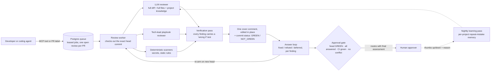

# BLAZE 2: an AI code reviewer that gets PRs to "safe to approve" in minutes

> **TL;DR** I designed, built and run an AI review service that reviews every pull request and design plan across a few dozen repositories, for several teams. A typical review goes from request to verdict in **about 4–6 minutes**, at **thousands of reviews a month**. Every finding has to state what would prove it wrong, and survive a verification pass, before it reaches a human. BLAZE never approves or merges anything itself: AI writes and reviews, and a person approves.

This is day-job work, so it names no company, customers or internal systems, and gives no confidential figures.

---

## Why it exists

One engineer plus a fleet of coding agents was shipping far more changes than human reviewers could read. Review, not writing code, had become the bottleneck. The goal was to automate the *reading* without removing the *human who approves*. Every change still gets a person's sign-off, but that person sees a verified, answered, CI-green PR with a final assessment, not a raw diff.

## Architecture

**Request.** A developer, or their agent, asks for a review through an MCP tool (the preferred path) or a GitHub label. Requests go into a Postgres-backed queue with **leases**, so a crashed worker's job is picked up again, and a PR's open review is shared, never run twice.

**Review.** A Node/TypeScript worker checks out the **exact head commit** and runs several reviewers in parallel: an LLM reviewer with the full diff, full files and project knowledge; a "tech-lead playbook" reviewer; and cheap deterministic scanners. The primary reviewer deliberately runs on a **different model or effort level than the one that wrote the code**, so the same blind spots don't line up.

**Verification.** Candidate findings go through a verification pass. Each surviving finding has a severity, a file and line, a stable ID, and a **"wrong if"** statement: the observation that would disprove it.

**Verdict and answers.** The result is one cover comment, edited in place, plus a commit status. Authors answer every finding: *fixed* (with the fixing commit), *refuted* (with evidence), or *blocked/deferred* (with a tracking link). Re-arming reviews the new head, and the answers are what clear the bar.

**Approval gate.** An approval request is accepted only when the current head is GREEN, every finding is answered, CI is green and there's no conflict. It is then routed to the right human with a final assessment.

**Surfaces.** An MCP server (Python on Vercel, Postgres on Supabase) exposes about 20 tools: request, wait, status, cover, explain, answer, re-arm, next step, request approval, feedback, merge-risk card, precheck, and QA runs. GitHub stays the source of truth for PR state.

## Engineering decisions

**False-positive control over finding count.** A finding blocks only if it is reachable in real use *and* caused by this PR. Medium and low findings can be *answered* instead of fixed, and a "final round" rule lets a clean round count as done, so reviews converge instead of looping. Because authors refute findings with evidence, **refutations are measured false positives**, and they feed nightly tuning.

**Exact-head discipline.** A verdict belongs to one commit. No stale GREEN is silently reused, and a verdict carried over after a base-only merge is re-confirmed, not trusted.

**Idempotency and crash safety.** Leased queue rows, shared open requests, and one in-place cover comment mean a restarted worker never double-reviews or double-posts.

**Safe self-deployment.** The service deploys itself from main: it snapshots the box, runs the test suite in a staged copy, installs in a quiet minute, proves health (units up, a real canary review, label pickup) and **rolls back on its own** if anything fails. The health check itself is tested, so a paused component can't trigger a false rollback.

**Cost and capacity control.** Per-hour caps, reviewer pools, memory-aware concurrency, and cheap scanners before expensive model calls.

**Learning from people, not just logs.** A thumbs up or down on a review or a single finding, with a one-line reason, feeds a nightly learning pass. A per-project **repeat-mistake list** (learned, plus hand-added past failures) goes into every review, aimed at the misses that matter. Merge-risk cards flag high-risk changes for extra human proof.

## What I learned

- **Make the AI show its work in a form it can lose.** The "wrong if" test turned vague concerns into claims that can be falsified, and that made precision measurable.
- **Make verdicts belong to commits, not PRs.** Most review-bot trust problems come from stale approvals.
- **Treat the human gate as a feature.** Speed came from removing the waiting, not the approver.

---

Related: [Dragon Front engineering case study](dragon-front.md) · [back to profile](../README.md)
