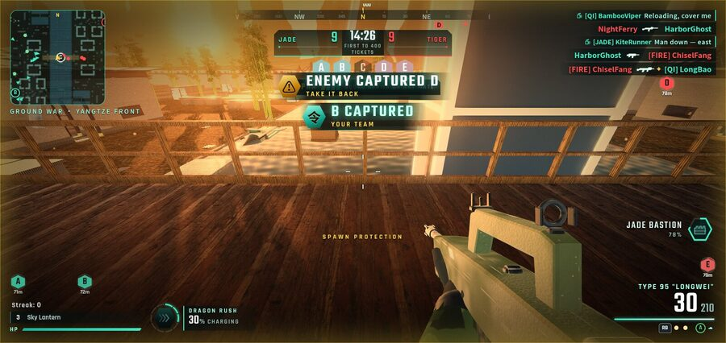
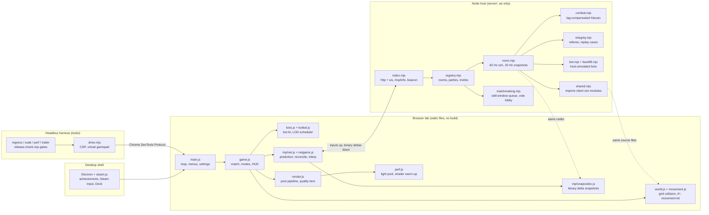

# Dragon Front: a browser FPS with an authoritative netcode stack, no engine, no build step



*Ground War: 20 v 20 five-flag domination, 39 bots plus the player, on one 208 x 150 m map.*

## TL;DR

Dragon Front is a Modern-Warfare-style first-person shooter that runs in a browser tab. It is built on Three.js r160 and plain ES modules, served as static files, with no bundler, transpiler or root `package.json`. Multiplayer goes through a small authoritative Node host. The host imports the client's own movement and collision modules, so prediction and server simulation run the same code.

Every number below comes from the repository (git history, `wc`, or the project's own measurement docs). The verification commands are at the end.

| | |
|---|---|
| Commits | **1,196** between 2026-10-15 and 2026-10-23, including **304** merges from **154** feature branches |
| Client | **324** JS modules, **94,147** lines, imported straight by the browser through an import map |
| Multiplayer host | **32** `.mjs` files, **5,216** lines, one runtime dependency (`ws`) |
| Tooling | **464** headless harness scripts in `tools/` (136 of them tests), plus **14** protocol-level tests in `server/`: **150** test scripts in total |
| Content | **20** maps, **52** weapons, **8** networked modes, **71** Steam achievements |
| Snapshot size | **14 B per player** in a full frame, about **3 B** for a player standing still in a delta. About **11 KB/s** down per client at 12 players (the earlier JSON prototype used about 35 KB/s at 8) |
| Host cost | **0.65 ms** average tick for 12 players, no tick over the 16.7 ms budget |
| Hitch work | Worst frame on Kowloon went from **7,728 ms to 152 ms** (cold shader cache, 2560x1440 High) |
| Docs | **35** design and engineering docs at the repo root, about **73k** words |

## Goals and constraints

- **Browser-first, no engine.** The game has to run from a static file server in a stock Chromium. Three.js covers the WebGL layer. Everything else is in-repo: grid collision, A\* pathfinding, the movement kit (slide, tac-sprint, double jump, wall-run, mantle), the post pipeline, bot AI, audio and UI.
- **No build step.** `index.html` has an import map and one `<script type="module">`. Vendored Three.js addons (GLTF/KTX2/Draco loaders, post passes) sit in `vendor/`. npm only appears inside `server/` (for `ws`) and `desktop/` (Electron). This rule shapes everything else. Edits show up on reload, and the server can `import()` client modules as they are.
- **Linux first.** Development and performance work happen on Arch Linux. Perf numbers are taken through ANGLE on the NVIDIA GL driver, which is the backend a stock Chromium uses on Linux. Test browsers are headless Chromium, with SwiftShader by default and the real GPU on request.
- **Headed for Steam.** An Electron shell (`desktop/`) adds a Steamworks layer that falls back to a recording stub when Steam is absent. It also covers achievements, rich presence, a Steam Deck preset (800p cap, 60 fps, dynamic resolution), Steam Input action sets, and a transport seam so `ISteamNetworkingSockets` can replace WebSockets later without touching the netcode.

## Architecture



The two dotted edges are the main design decision. The host does not carry a port of the movement code or the snapshot format. It loads the actual client files.

## Deep dive 1: Authoritative netcode in plain Node

**Problem.** A fast movement shooter needs responsive local movement, consistent hit registration at 50 to 150 ms latency, and a host that cannot be talked into teleports or wall shots. There is no engine providing replication, and the eventual Steam transport is unreliable and unordered.

**Approach.**

- **One simulation, two runtimes.** `server/shared.mjs` uses a Node module hook to stub `scenery.js` and imports the client's `world.js`, `movement.js` and `data.js`. `selftest.mjs` checks that host and client produce the same result: 0 m error over 360 commands of sprint, jump, slide and strafe.
- **Inputs only.** Clients send commands `{seq, epoch, dt, actions, yaw, pitch}` about every 30 ms. The host integrates them at 60 Hz on a wall-clock budget (x1.15), so a client cannot simulate faster than real time. Positions never travel upstream.
- **Prediction and reconciliation.** Each snapshot carries the host state after command `ack`. If the stored prediction for that command is off by more than 4 cm, the client rewinds to the host state and replays its unacknowledged commands. The body snaps to the corrected position. The camera eases over (60 ms half-life) unless the error is above 1.5 m, which only a real teleport produces.
- **Binary delta snapshots.** At 20 Hz, a player row is quantised to 1 cm positions and 16-bit yaw, 14 B in total. Deltas go against the newest tick the client acknowledged. A missing or stale ack falls back to a full frame, so a lost packet costs one larger frame and never corrupts state. On lossy transports every command packet repeats the last 10 commands. At 5 % loss in `lagtest` that cut corrections from 13 to 1.

```js
// js/mp/snapcodec.js: per-row change mask against the acknowledged baseline
const b = baseMap.get(q[0]);
if (!b) { buf[o++] = 0x80; full(q); continue; }
let mask = 0;
if (q[1] !== b[1] || q[2] !== b[2] || q[3] !== b[3]) mask |= 1;
if (q[4] !== b[4] || q[5] !== b[5]) mask |= 2;
if (q[6] !== b[6]) mask |= 4;
if (q[7] !== b[7]) mask |= 8;
buf[o++] = mask;
if (mask & 1) { dv.setInt16(o, q[1]); dv.setInt16(o + 2, q[2]); dv.setInt16(o + 4, q[3]); o += 6; }
if (mask & 2) { dv.setUint16(o, q[4]); dv.setInt16(o + 2, q[5]); o += 4; }
if (mask & 4) buf[o++] = q[6];
if (mask & 8) buf[o++] = q[7];
```

- **Lag compensation.** A shot carries `rt`, the host time the shooter was looking at (from the clock-synced render time). The host keeps a 1 s position history per player and rewinds every candidate to `rt`, capped at 500 ms. It ray-casts against the world first, so walls still stop shots, and then against shared hitboxes (`js/mp/hitbox.js`). Players the shooter's own screen showed under the crosshair get 18 cm of grace, so a hit that looked clean is not lost to animation lean.
- **Integrity.** `integrity.mjs` acts as referee: a host-side ammo and reload model, token-bucket fire rates, an origin check (within 2.5 m of the host's eye and with line of sight), clock-drift checks, and aim statistics. Suspicion is a weighted, decaying score. A single check can drop one shot or open a replay case. Only sustained evidence from two independent categories removes a player. `SECURITY.md` lists what is not defended (ESP, humanlike triggerbots, collusion).
- **Around the match.** Matchmaking uses a skill window that widens with wait time (150 rating, +45 per second) and Elo-style ratings. Teams are balanced by rating. Parties stay together. Bots fill empty seats after 7 s, or 13 s for a solo player. Dropped players keep their seat for 45 s and rejoin with a session token. Host migration is a limited version: in the lobby, the next player inherits the room; mid-match, the game ends gracefully with results for everyone.

**Trade-offs.**

- The host trusts client aim, as most shooters do. It also sends every position in every snapshot, which leaves the game open to wallhacks. Visibility-culled snapshots are the documented next step.
- Scenery props are placed with a non-seeded RNG at quality-dependent densities, so props are walk-through in net matches and both sides collide only with the deterministic grid. Making props match across machines means seeded, quality-independent placement plus baked colliders. That is on the list.
- Equipment, killstreaks and abilities are not replicated yet.

**Evidence.** `realnettest.mjs` runs five scripted humans on simulated links (3 ms LAN up to 120 ms ±40 ms with 6 % loss) against bots. It asserts that every client decodes identical rows and an identical scoreboard for the same host tick: 153 common ticks, 0 mismatches, with binary deltas, loss and resends all active. It also checks that a socket cut mid-match comes back as the same player. Running that test found the worst bug of the netcode work. The interpolation delay was sized from clock samples taken while the map was still loading, so it sat at 2 to 10 s and made every lag-compensated shot miss.

## Deep dive 2: 40-combatant bot AI, a squad director and a LOD scheduler

**Problem.** Ground War puts 40 combatants on one map: five flags, squads of four, squad spawns and vehicles. Every bot runs perception (line of sight plus reaction delay), A\* pathfinding, strafing, burst fire and reload. Bots also have to play the objective, not just mill around.

**Approach.**

- **Director above the bots.** Every 1.2 s, `GroundWar.think()` scores each flag for each team. Enemy or neutral flags count as attack targets, threatened flags as defend targets, and quiet flags as low-value defends. It then assigns each squad the cheapest order by distance divided by value, plus a load penalty, with at most two squads per flag. A small bias toward keeping the current order prevents flapping. The player's squad follows the player and rejoins the front after 8 s of idling. Bots with the slayer role hunt instead about 30 % of the time.
- **Personas and tiers.** The single-player elite AI provides a tier table (turn rate, flanking, squad knobs) and personas (rusher, anchor, sniper, support) that pick the weapon and fight range. The multiplayer host reuses the same tiers for backfill bots. In `auto` mode the tier adapts every 12 s, by at most one step, based on human K/D.
- **LOD scheduler.** `js/botlod.js` splits simulation into AI ticks and animation ticks, using a per-frame camera frustum and distance tiers. Far and off-screen bots animate every 2nd or 4th frame and are hidden beyond 190 m. Idle far bots think every 2nd or 3rd frame with the accumulated dt, so they do not drift. Bots that are fighting, hurt, or within 45 m of the player always run every frame.

```js
// js/botlod.js: skipped frames bank their dt, so a throttled bot covers the same ground
const busy = bot.target || bot.health < bot.maxHealth || d < this.busyR || bot.exec || this.g.frozen;
every = busy || t < 2 ? 1 : t === 2 ? 2 : 3;
if (every === 1) { const r = dt + a.ai; a.ai = 0; this.stats.aiRun++; return r; }
a.ai += dt;
if ((this.frame + this.id(bot)) % every) { this.stats.aiSkip++; return 0; }
const r = a.ai; a.ai = 0; this.stats.aiRun++;
return r;
```

The `(frame + id) % every` stagger spreads skipped bots evenly across frames instead of creating a spike every Nth frame. The same class serves Onslaught (60+ enemies on screen) through mode knobs: `lodScale` pulls in every ring, `lodCrowd` loosens the busy rule, and `ANIM_BUDGET` sets a hard ceiling of 22 soldiers posed per frame.

**Trade-offs and honest status.** The QA re-check found that `tools/perf.mjs` had hard-coded `tdm`, so the first Ground War numbers were really from a 12-combatant match. After the tool was fixed to honour `MODE=gw`, the measured 40-combatant cost on a Radeon iGPU at 720p High was p50 62 to 67 ms. The LOD made no measurable difference on that machine. `GROUNDWAR.md` records this directly: the 40-combatant frame is not yet within a 33 ms budget. The next step is a `PROFILE=1` bot/render split before setting a budget. On the content side, the first map build cost 93 ms per frame because each crate cell placed three 22k-triangle baskets (9 M instanced triangles). Large maps now use cheaper dressing, and the sun shadow follows the camera.

## Deep dive 3: The rendering pipeline and the hitch budget

**Problem.** The game uses a full post stack in WebGL: scene to HDR target, height fog plus sun shafts, GTAO, enemy outline, TAA, viewmodel, bloom, ACES, grade, SMAA. It runs across six quality tiers from Mobile to Ultra, including a Steam Deck tier. Steady-state frame time on desktop was fine. The problem players actually felt was multi-second freezes.

**Approach.** I built `tools/perf.mjs` first. It runs headless Chromium on the real GPU with cold shader caches, steps each frame from the page (`__df.hold` + `__df.step`, then `gl.finish()`) so every sample is the full CPU+GPU cost, and fires every killstreak, ability, equipment item, killcam and the podium on every map. It also tracks `renderer.info.programs` growth, since any growth mid-match is a compile stall. That pointed to two causes:

1. **Light-count changes.** Adding a `PointLight` at runtime changes the light count, and Three.js then recompiles every lit material in the scene: 4.0 to 5.9 s on the GL backend. `LightPool` pre-allocates 4 lights and hands out handles. It also patches `scene.add` to track foreign point lights and parks a pooled light for each one, so the visible light count never changes.
2. **First-use compiles.** `registerWarmup()` lets each module compile its materials during the countdown. A `CompileGuard` hides new top-level objects until the driver reports their programs linked, so an uncovered effect appears a few frames late instead of freezing the game.

```js
// js/perf.js: keep the visible light count constant so three.js never recompiles the scene
_balance() {
  let want = 0;
  for (const l of this.foreign) { const v = this._visibleInScene(l); if (v === null) this.foreign.delete(l); else if (v) want++; }
  while (this.parked.length > want) this.parked.pop().l.visible = true;
  while (this.parked.length < want) { const s = this.slots.find((x) => !x.used && x.l.visible); if (!s) break; s.l.visible = false; this.parked.push(s); }
}
```

**Results (cold shader cache, 2560x1440 High, RTX 5070 Ti via ANGLE-GL).**

| map | worst hitch before | after |
|---|---|---|
| Kowloon | 7,728 ms | 152 ms |
| Shaolin | 6,847 ms | 159 ms |
| Docks | 6,267 ms | 56 ms |
| Guilin | 5,147 ms | 108 ms |
| Great Wall | 4,977 ms | 456 ms |
| Forbidden Court | 4,634 ms | 325 ms |

At steady state on that GPU, every map ran p50 between 2.7 and 6.4 ms at 1440p. Turning GTAO, shafts, the 4096² shadow map, or render scale on and off each changed the result by about a millisecond. So no quality was cut. Kowloon is the one map near the 8.3 ms (120 fps) budget. Lowering render scale does not help there, which means it is bound by draw calls and CPU, not fill rate: the wet-street reflector draws the scene a second time.

**Load-time work.** On software GL, the first loads had 6 to 14 s `getProgramParameter` blocks and a 2 to 5 s synchronous world build. The world build is now a generator (`sceneryGen`) stepped in roughly 40 ms slices behind the loading card. Its seeded PRNG carries across slices, so the geometry and the baked-lightmap checksum match the one-go build exactly. PMREM and impostor programs are linked before first use.

**Trade-offs.** Rebuilding the pipeline on a mid-match quality change still recompiles post shaders. Static scenery still updates its matrices every frame, which was the top self-time entry in one Great Wall profile. The sun shadow pass still renders every caster every frame. All three are written up in `PERF_FINDINGS.md` with the measured cost and the proposed fix, addressed to the module that owns the code.

## Deep dive 4: A headless playtest harness and deterministic trailer capture

**Problem.** A game this size, built quickly and largely in parallel, breaks in ways that unit tests miss: a mode that never leaves the pre-match freeze, a menu a controller cannot reach, a shader that compiles on first kill, a baked lightmap that no longer matches its map. The checks have to drive the real game.

**Approach.**

- **`tools/drive.mjs`** launches headless Chromium (SwiftShader by default, real GPU with `DRIVE_GPU=1`) and serves the current checkout over the DevTools protocol, so a stale server can never put other code under test. It installs a virtual standard-mapping gamepad before any page script runs and exposes `ev`, `shot`, `pad.press`, `key` and `logs` to a test script. A per-evaluate timeout and a whole-session watchdog keep a wedged renderer from hanging a run.
- **Deterministic stepping.** The main loop has two test seams. `manual` freezes wall-clock logic so `__df.tick(n)` advances the simulation in fixed steps. `perfHold` stops the rAF loop entirely so a harness owns every frame.

```js
// js/main.js: test seams in the main loop
let manual = false; // tests: __df.manual(true) + __df.tick(n) step the logic deterministically (rendering continues)
let perfHold = false; // tools/perf.mjs: __df.hold(true) stops the rAF loop so __df.step(dt) owns every frame
function frame(now) {
  requestAnimationFrame(frame);
  if (perfHold) { last = now; return; }
  if (!limiter.shouldRun(now)) return; // FPS limit: skip this vsync
  const frameMs = now - last;
  const dt = Math.min(0.1, frameMs / 1000);
  last = now;
  const t0 = performance.now();
  logic(manual ? 0 : dt, !manual);
  // ...
```

- **What runs on top.** `regress.mjs` plays about 150 s of bot TDM per map from a fresh profile. It fails on page exceptions, fewer than 5 kills, any synthesized-audio oscillator, a match clock that never moves, or a stale GI bake, and it reports load stall separately from live stall. `soak.mjs` cycles every mode and map, Dynasty Defense arenas, campaign missions and online rooms against a local host. `ttk-table.mjs --check` enforces weapon class roles. `tools/release-check.mjs` combines all of this into a gate table: clean tree, no synthesized audio, movement kit, weapon balance, save migration, save-corruption guard, crash-log tail, no open S1 bugs in `BUGS.md`, pad-only restore picker, regression, and soak. Exit 0 means `RELEASE OK`.
- **Shared machine hygiene.** A wrapper in `tools/bin/chromium` caps concurrent test browsers, waits when free memory drops under a threshold, and reaps orphaned headless browsers. It was added after two stuck browsers held both slots for 13 hours.
- **Trailer capture.** `tools/trailer.mjs` is a `drive.mjs` script. It starts live bot matches, hides the HUD, and plays a storyboard of shots: `fly` (Catmull-Rom between named views derived from each map's objective layout), `hero` (orbit the bot with the most soldiers within 12 m, pulling the camera in until it has line of sight), and `chase`. For every output frame it sets the camera pose for time `t`, calls `__df.step(1/FPS)`, and captures a JPEG through CDP. ffmpeg then encodes VP9 WebM. Game time advances exactly one frame per captured frame, so a slow software renderer produces the same-length trailer with correct motion. `tools/steam-assets.mjs` reuses the same camera kit for store capsules and screenshots.

**Trade-offs.** SwiftShader frame rates mean nothing, so perf numbers come only from the real-GPU path. The trailer uses fixed steps, but bot decisions still use `Math.random`, so two captures match in timing, not frame for frame. Seeding the bot RNG would make captures reproducible down to the pixel. Some tests are also tied to UI text and have gone stale as screens changed. The netcode playtest found and fixed four.

## How I work

- **Design docs before code, measurements after.** Each epic has a document: `MULTIPLAYER.md`, `GROUNDWAR.md`, `SECURITY.md` (threat model and thresholds), `BALANCE.md` (generated from the live weapon table), `ART_BIBLE.md` (pillars, palette, per-map targets), `ASSET_PIPELINE.md`, `STEAM.md` and `STEAM_DECK.md` (checklists against Valve's Verified categories). The docs record what is not done or not working in the same detail as what shipped. The Ground War perf caveat above comes straight from its doc.
- **Agent-assisted development with review.** 1,033 of the 1,196 commits are co-authored with Claude. I ran work as parallel epics on separate branches (154 merged) with clear file ownership. Cross-cutting findings go to the owning module as written hand-offs; `PERF_FINDINGS.md` is addressed to "files owned by other agents". Each epic ends with a QA pass and an integration pass, and nothing merges without the harness confirming it.
- **Regression gates over trust.** "It works on my screen" is not a merge criterion. Netcode changes go through `realnettest`/`lagtest`. Map changes go through `map-check --strict` and the GI staleness check in `regress`. Release tags require `release-check.mjs` to print `RELEASE OK` and a short manual controller pass to be ticked.

## What I'd do next

1. **Bring Ground War under 33 ms.** Profile the bot/render split with `PROFILE=1`. Move the A\* path search to reusable typed arrays with connected-component early-out (already specified in `PERF_FINDINGS.md`). Then budget per subsystem.
2. **Deterministic scenery and solid props online.** Seed and decouple prop placement from graphics quality, bake per-map colliders, and verify the existing load-time collision hash on both sides.
3. **Visibility-culled snapshots** to close the ESP gap, plus replicated entities for grenades, equipment and killstreaks.
4. **Ship the Steam transport.** Implement the native side of `SteamTransport`/`SteamListener` over `ISteamNetworkingSockets` (SDR relay, unreliable lane for state). The binary delta codec and command redundancy were built for exactly that loss model.
5. **Shadow and matrix work.** Render static shadow casters once and keep a small player-centred cascade. Freeze matrices on static scenery.
6. **Seeded bot RNG** so trailer captures and regression runs reproduce frame for frame.

## Verifying the numbers

All commands run from the root of the Dragon Front repository.

| Figure | Command |
|---|---|
| 1,196 commits, date range | `git log --oneline \| wc -l`; `git log --format=%ad --date=short \| sort \| uniq -c` |
| 304 merges | `git log --merges --oneline \| wc -l` |
| 154 merged feature branches | `git log --merges --format=%s \| grep -oE '<branch-prefix>/[A-Z0-9-]+' \| sort -u \| wc -l` |
| 1,033 co-authored commits | `git log --format=%b \| grep -ci 'co-authored-by: claude'` |
| 324 modules / 94,147 lines | `git ls-files 'js/*.js' \| wc -l`; `git ls-files 'js/*.js' \| xargs cat \| wc -l` |
| 32 host files / 5,216 lines | `git ls-files 'server/*.mjs' \| wc -l`; `wc -l server/*.mjs` |
| 464 harness scripts / 150 tests | `ls tools/*.mjs \| wc -l`; `ls tools/*test*.mjs \| wc -l` (136) plus `ls server/*test.mjs \| wc -l` (14) |
| 20 maps, 52 weapons | `node -e "import('./js/data.js').then(m => console.log(Object.keys(m.MAPS).length, Object.keys(m.WEAPONS).length))"` |
| 71 achievements | `node desktop/scripts/list-achievements.mjs --csv` (rows after the header) |
| Three.js r160, no build | `grep -o "REVISION = '[0-9]*'" vendor/three.module.js`; no root `package.json` |
| Snapshot, tick, hitch, realnet figures | `server/README.md`, `MULTIPLAYER.md`, `PERF_FINDINGS.md`, `GROUNDWAR.md` (reproduce with `server/loadtest.mjs`, `server/realnettest.mjs`, `tools/perf.mjs`) |
